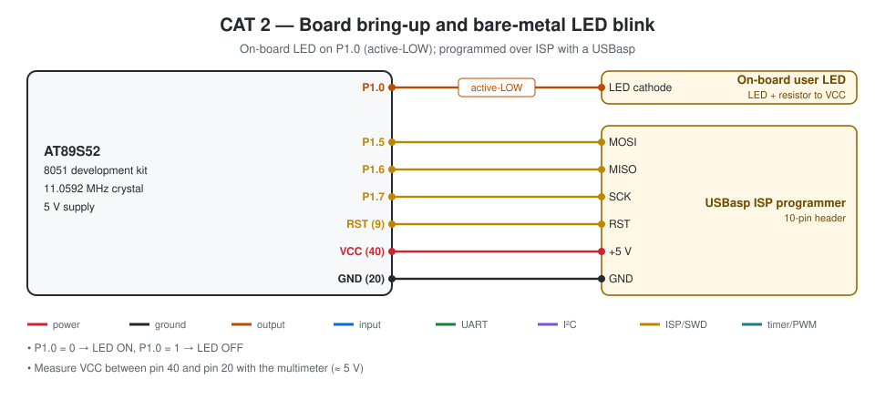

# CAT 2 — 8051 Tool Chain, Bare-Metal LED Blink and Delay Library

| Field | Details |
|---|---|
| Experiment | Continuous Lab Evaluation 2 |
| Date | 20/09 (Week 2) |
| Experiment name | 8051 Tool Chain Setup – Development Board – AT89S52 |
| Platform | AT89S52 development kit (8051 core, 11.0592 MHz crystal) |
| Tools | Keil µVision 5 (C51), progisp + USBasp ISP programmer |

## Circuit Diagram

| Signal | Pin | Notes |
|---|---|---|
| User LED | P1.0 | on-board, **active-LOW** (0 = ON) |
| ISP | P1.5 MOSI, P1.6 MISO, P1.7 SCK, RST | USBasp 10-pin header |
| Supply | VCC pin 40, GND pin 20 | 5 V |

---

## Task 1 — Hardware Board Bring-Up

**Project folder:** [`Task1_Board_BringUp`](Task1_Board_BringUp/)

### Working principle
The board parts were identified from the schematic, the 5 V rail was checked with a multimeter, the LED was traced to P1.0 (active-low) and the PC was connected to the AT89S52 through the USBasp ISP programmer.

| Parameter | Entry |
|---|---|
| MCU | AT89S52 |
| CPU core | 8051 (MCS-51), 8-bit, 12 clocks / machine cycle |
| Operating voltage | 5 V (4.0 – 5.5 V) |
| Debug interface | none on-chip; ISP over SPI (USBasp + progisp) |
| LED GPIO port / pin | Port 1 / P1.0 |
| LED active state | LOW |
| LED frequency | ≈ 1 Hz |

### Pseudocode
1. Identify MCU, programmer, power input and user LED on the schematic.
2. Measure VCC between pin 40 and pin 20.
3. Trace the LED to P1.0 and note the active-low wiring.
4. Install the USBasp driver, build in Keil and flash the HEX with progisp.

### Code base
- No program — the Task 2 project is used to prove the tool chain.
- `BringUp_Sheet.md` holds the sheet with spaces for the measured values.

### Inference
The board was powered, identified and programmed from the PC, so the tool chain is ready for bare-metal programs.

---

## Task 2 — Bare-Metal LED Blink

**Project folder:** [`Task2_Bare_Metal_LED_Blink`](Task2_Bare_Metal_LED_Blink/)

### Working principle
`sbit USER_LED = P1^0;` maps the LED onto bit 0 of the Port-1 SFR (0x90). The 8051 has no direction register, so writing the bit drives the pin. A nested software loop gives about 0.5 s: the inner counter is `volatile` so an optimising compiler cannot delete the loop; one outer pass ≈ 2086 cycles (2.26 ms, measured in the uCsim simulator) and 221 passes ≈ 0.5 s.

### Pseudocode
1. Include `reg52.h`.
2. Map P1.0 with `sbit` and define LED_ON = 0, LED_OFF = 1.
3. Write `soft_delay()` with nested loops (~0.5 s).
4. LED ON, delay; LED OFF, delay.
5. Repeat forever.

### Code base
- `main.c` — `soft_delay(HALF_PERIOD_PASSES)` with `HALF_PERIOD_PASSES = 221`
- `Task2_Bare_Metal_LED_Blink.uvproj`, `STARTUP.A51`

### Inference
The LED blinks at about 1 Hz using only direct SFR access and a software loop.

---

## Task 3 — Custom Library Function for Delay

**Project folder:** [`Task3_Custom_Delay_Library`](Task3_Custom_Delay_Library/)

### Working principle
The delay is moved into `delay.h` / `delay.c`. `delay_ms(n)` repeats a ~1 ms block (two DJNZ loops of 228 passes + overhead = 12 + 4 × 228 = 924 cycles ≈ 1.003 ms). `delay_50us()` is added for short device timings (used later by the LCD driver).

### Pseudocode
1. Declare `delay_ms()` and `delay_50us()` in `delay.h`.
2. Implement the calibrated loops in `delay.c`.
3. In `main.c` include `delay.h`.
4. LED ON, `delay_ms(500)`; LED OFF, `delay_ms(500)`.
5. Repeat.

### Code base
- `delay.h` — interface and timing notes
- `delay.c` — calibrated loops
- `main.c` — 1 Hz blink with `delay_ms(BLINK_HALF_MS)`

### Inference
With the delay in its own library the application states the time it wants in milliseconds, and the same library is reused in CAT 3 – 7.
