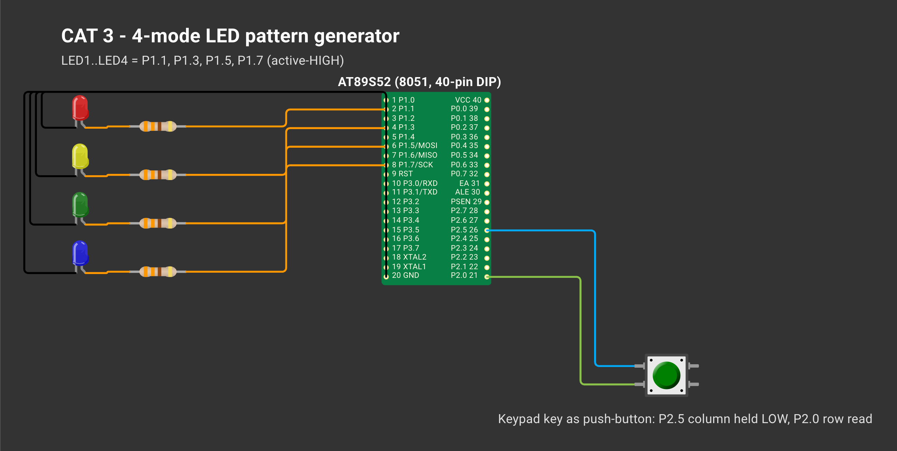

# CAT 3 — Four-State LED Pattern Generator with a Debounced Button

| Field | Details |
|---|---|
| Experiment | Continuous Lab Evaluation 3 |
| Date | 27/09 (Week 2) |
| Experiment name | Timer-Based LED Pattern Generator and Button Controller |
| Platform | AT89S52 development kit (8051 core, 11.0592 MHz crystal) + 4 LEDs + push-button |
| Tools | Keil µVision 5 (C51), progisp + USBasp ISP programmer |

## Circuit Diagram

*Drawn on [Wokwi](https://wokwi.com). To open and edit it: start a new project on wokwi.com, paste [`wokwi/diagram.json`](wokwi/diagram.json) into its diagram.json tab, and add the `wokwi/*.chip.json` files (if any) with **New file**. The AT89S52, USB-TTL, ULN2003, USBasp and ST-LINK boards are custom chips (pin names added as labels). The ESP-01 part stands in for the Wemos D1 mini and the BMP180 module for the BME280 (same AT firmware / same 4-pin I²C header); the Nucleo-64 graphic is labelled as the F401RE.*

| Signal | Pin |
|---|---|
| LED1 / LED2 / LED3 / LED4 | P1.1 / P1.3 / P1.5 / P1.7 (active-HIGH, 330 Ω) |
| Push-button | keypad key: P2.5 held LOW, P2.0 read |

---

## Activity — Four-State LED Control System

**Project folder:** [`.`](./)

### Working principle
The system is a state machine in `mode`. `leds_write(pattern)` writes a 4-bit pattern (bit 3 = LED1 … bit 0 = LED4) so every mode only has to compute a pattern. `button_pressed_event()` is called once per 10 ms loop and accepts a level change only after it has been seen in 2 consecutive samples (20 ms) — no delay inside the debounce — and reports only the released → pressed edge, so one press gives exactly one transition. The pattern steps every 300 ms, so the button stays responsive.

| Mode | LED1 LED2 LED3 LED4 |
|---|---|
| 0 | 0000 (power-on) |
| 1 Running | 1000 → 0100 → 0010 → 0001 |
| 2 Binary | 0000 → … → 1111 |
| 3 Alternate | 1010 ↔ 0101 |
| 4 Flash | 1111 ↔ 0000 |

### Pseudocode
1. Hold the key column low, LEDs OFF, `mode = 0`.
2. Every 10 ms check `button_pressed_event()`; on a press go to the next mode (4 → 1) and reset the step.
3. Every 30 loops compute `pattern_for(mode, step)` and write it.
4. Advance `step` (wrap 4 for running, 16 for binary).

### Code base
- `main.c` — `leds_write()`, `button_pressed_event()`, `pattern_for()`
- `delay.c/.h` — `delay_ms()` from CAT 2
- `CAT03_Button_LED_Pattern_Generator.uvproj`

### Inference
Each press moves the controller to the next mode exactly once; a single state variable plus a debounced edge detector keeps the logic small.
