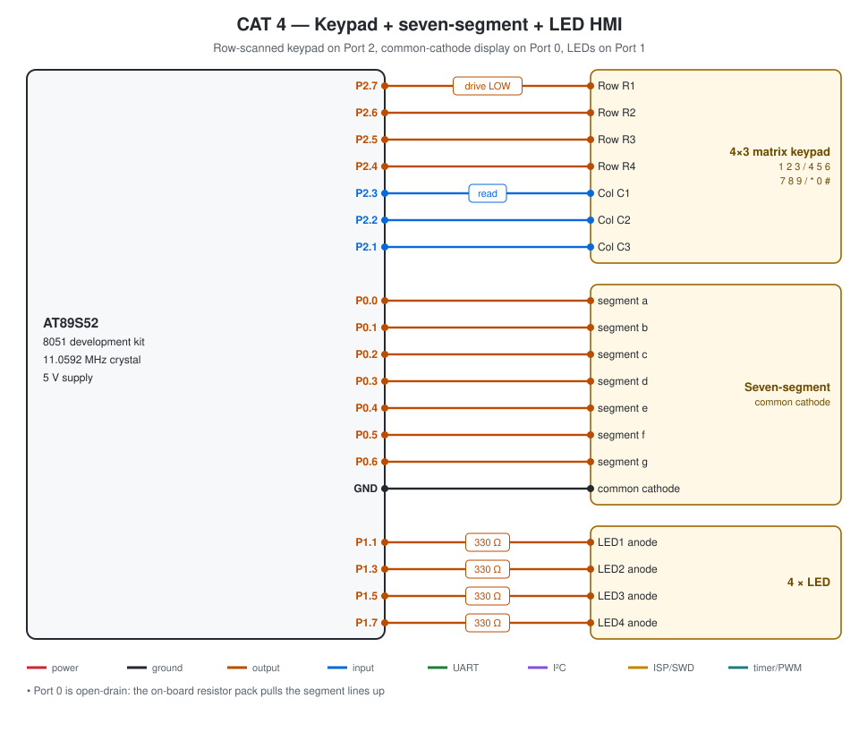

# CAT 4 — HMI with Matrix Keypad, LEDs and Seven-Segment Display

| Field | Details |
|---|---|
| Experiment | Continuous Lab Evaluation 4 |
| Date | 03/08 (Week 3) |
| Experiment name | Human-Machine Interface using Matrix Keypad, LEDs and Seven-Segment Display |
| Platform | AT89S52 development kit (8051 core, 11.0592 MHz crystal) + keypad + 7-segment + 4 LEDs |
| Tools | Keil µVision 5 (C51), progisp + USBasp ISP programmer |

## Circuit Diagram

| Signal | Pins |
|---|---|
| Keypad rows R1–R4 | P2.7–P2.4 (driven) |
| Keypad columns C1–C3 | P2.3–P2.1 (read) |
| 7-segment a–g | P0.0–P0.6 (common cathode) |
| LED1–LED4 | P1.1, P1.3, P1.5, P1.7 |

---

## Task — Keypad-Controlled Display and LED Operations

**Project folder:** [`.`](./)

### Working principle
One keypad row is driven LOW at a time (`P2 = ~(0x80 >> row)`) and the column bits are read; a key is confirmed by a 15 ms re-read and reported once per press. `KEYMAP[4][3]` and `SEG_CODE[10]` are look-up tables in code memory.

| Key | Display | LED operation |
|---|---|---|
| 1–4 | 1–4 | LEDn ON |
| 5 | 5 | running LED |
| 6 | 6 | alternate 1010 ↔ 0101 |
| 7 | 7 | binary counter 0–15 |
| 8 | 8 | blink all |
| 9 | 9 | all OFF |
| 0 | 0 | reset |

### Pseudocode
1. LEDs OFF, display blank.
2. Every 10 ms `keypad_scan()`.
3. On a new key: `display_digit(key)` and `led_control(key)`.
4. Every 250 ms advance the active pattern (`running_led()`, `alternate_led()`, `binary_counter()` or `blink_all()`).

### Code base
- `keypad_scan()`, `display_digit()`, `led_control()`, `running_led()`, `binary_counter()`, `alternate_led()`, `blink_all()` — the functions the sheet asks for
- `delay.c/.h`

### Inference
Each key is shown on the display and starts its LED function; 12 keys are read with 7 pins, and separate functions keep the interface easy to extend.
