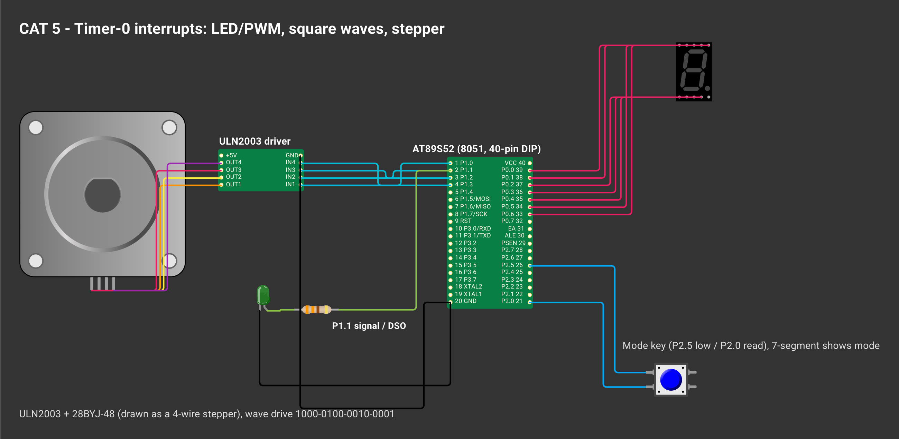

# CAT 5 — Hardware Timer Interrupts: LED Fading, Pulse Generation, Stepper Control

| Field | Details |
|---|---|
| Experiment | Continuous Lab Evaluation 5 |
| Date | 10/08 (Week 4) |
| Experiment name | Hardware Timer and Interrupt-Based Timing for LED Fading, Pulse Generation and Stepper Motor Control |
| Platform | AT89S52 development kit (8051 core, 11.0592 MHz crystal) + LED + DSO + ULN2003/28BYJ-48 |
| Tools | Keil µVision 5 (C51), progisp + USBasp ISP programmer, DSO |

## Circuit Diagram

*Drawn on [Wokwi](https://wokwi.com). To open and edit it: start a new project on wokwi.com, paste [`wokwi/diagram.json`](wokwi/diagram.json) into its diagram.json tab, and add the `wokwi/*.chip.json` files (if any) with **New file**. The AT89S52, USB-TTL, ULN2003, USBasp and ST-LINK boards are custom chips (pin names added as labels). The ESP-01 part stands in for the Wemos D1 mini and the BMP180 module for the BME280 (same AT firmware / same 4-pin I²C header); the Nucleo-64 graphic is labelled as the F401RE.*

Crystal 11.0592 MHz → machine cycle 1.085 µs → Timer 0 → overflow → **interrupt** → software time base → action

| Time base | Counts | Setting |
|---|---|---|
| 1 ms | 922 | Mode 1, TH0:TL0 = 0xFC66 (+12 for ISR entry → 0xFC72), reloaded in the ISR |
| 100 µs | 92 | Mode 2 auto-reload, TH0 = 0xA4 |

---

## Task 1 — Timer 0 Interrupt, 1 s Software Time Base

**Project folder:** [`Task1_Timer0_Interrupt_1s_LED`](Task1_Timer0_Interrupt_1s_LED/)

### Working principle
The Timer-0 ISR (vector 1, register bank 1) reloads 0xFC66 and counts 1 ms ticks. After 1000 ticks it sets `second_flag`; the main loop toggles the LED when it sees the flag. No delay loop is involved in the timing.

### Pseudocode
1. TMOD = Mode 1, load 0xFC66, ET0 = EA = TR0 = 1.
2. ISR: reload, `++ms_ticks`; at 1000 set `second_flag`.
3. Main: if `second_flag`, clear it and toggle P1.1.

### Code base
- `main.c` — `timer0_isr() interrupt 1 using 1`, `timer0_init_1ms()`

### Inference
The LED changes exactly every second because the hardware timer produces the timing and the software only responds to the event.

---

## Task 2A — Software PWM LED Fading

**Project folder:** [`Task2A_Software_PWM_LED_Fade`](Task2A_Software_PWM_LED_Fade/)

### Working principle
A 100 µs interrupt drives a 10-slot PWM (1 ms period → 1 kHz, no flicker). `duty` (0–10) sets how many slots the LED is on. Every 100 ms the duty steps by 10 %: 0 → 100 → 0 % in 2 s.

### Pseudocode
1. Timer 0 Mode 2, TH0 = TL0 = 0xA4.
2. ISR: advance `pwm_slot` 0–9, LED = (`pwm_slot < duty`); count 1000 ticks → `step_flag`.
3. Main: on `step_flag` add `direction` to `duty`, reverse at 0 and 10.

### Code base
- `main.c` — PWM and fade time base in one short ISR

### Inference
The LED brightens and dims smoothly; the brightness follows the duty cycle while the 1 kHz PWM frequency stays constant.

---

## Task 2B — Variable-Frequency Square Wave

**Project folder:** [`Task2B_Variable_Frequency_Square_Wave`](Task2B_Variable_Frequency_Square_Wave/)

### Working principle
The ISR toggles P1.1, so the frequency depends only on the reload value: half-period counts N = 460800 / f.

| Mode | f | N | Reload |
|---|---|---|---|
| 1 | 100 Hz | 4608 | 0xEE00 |
| 2 | 500 Hz | 922 | 0xFC66 |
| 3 | 1 kHz | 461 | 0xFE33 |
| 4 | 2 kHz | 230 | 0xFF1A |
| 5 | 5 kHz | 92 | 0xFFA4 |

`ISR_LATENCY` adds back the cycles between overflow and reload.

### Pseudocode
1. Compute reload = 65536 − N + ISR_LATENCY for the mode.
2. ISR: reload, toggle P1.1.
3. Key press → next mode, show 1–5 on the 7-segment.

### Code base
- `main.c` — `HALF_PERIOD[]` table, `set_mode()`

### Inference
All five frequencies come from the same interrupt routine; only the timer reload changes.

---

## Task 2C — Different Signal Types

**Project folder:** [`Task2C_Signal_Patterns`](Task2C_Signal_Patterns/)

### Working principle
Waveforms are strings of `1`/`0` played by the 100 µs interrupt, one bit every 0.5 ms: square `10`, variable duty `11110000`, pulse train `1000000000`, burst `1010101010` + ten `0`.

### Pseudocode
1. Timer 0 Mode 2, 100 µs.
2. ISR: every 5 ticks output the next bit of the current pattern.
3. Key press → next pattern.

### Code base
- `main.c` — `PATTERNS[]`, `select_pattern()`

### Inference
Any digital waveform can be generated from one timer interrupt by storing its bit pattern.

---

## Task 3 — Stepper Motor Speed and Direction (optional)

**Project folder:** [`Task3_Stepper_Motor_Speed_Direction`](Task3_Stepper_Motor_Speed_Direction/)

### Working principle
The 1 ms ISR counts to `step_ms` and then outputs the next wave-drive step (1000 → 0100 → 0010 → 0001) on P1.0–P1.3, so the timer interval sets the speed. Keys: 1 slow (100 ms), 2 medium (50 ms), 3 fast (10 ms), 4 reverse, 5 stop/start.

### Pseudocode
1. Timer 0, 1 ms interrupt.
2. ISR: `++ms_count`; at `step_ms` advance `phase` ±1 and write `STEP_SEQ[phase]`.
3. Main: read the keypad and change `step_ms`, `clockwise` or `running`.

### Code base
- `main.c` — `STEP_SEQ[]`, `keypad_get()`

### Inference
Motor speed and direction are set only by the interrupt interval and step order, independent of the key-handling code.
