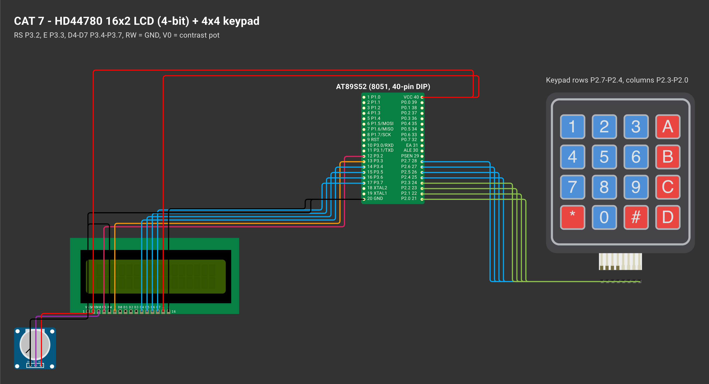

# EXPERIMENT DETAILS

**EXP:** CONTINUOUS ASSESSMENT 7

**DATE:** 24/08/2026

**NAME OF EXP:** 16×2 LCD Driver Development and Dynamic Display Control

**HARDWARE SETUP / PLATFORM:** AT89S52 development kit (8051 core, 11.0592 MHz crystal) + HD44780 16×2 LCD + 4×4 keypad — Keil µVision 5 (C51), progisp + USBasp ISP programmer, HD44780 datasheet

---

## TASK 7C : 4×4 Keypad Character Movement

### 1. Circuit Diagram

| LCD | 8051 | Role |
|---|---|---|
| RS | P3.2 | 0 command / 1 data |
| E | P3.3 | latch on falling edge |
| D4–D7 | P3.4–P3.7 | 4-bit bus |
| RW | GND | write only |
| V0 | 10 k pot | contrast |

Keypad: rows P2.7–P2.4, columns P2.3–P2.0.

*Drawn on [Wokwi](https://wokwi.com). To open and edit it: start a new project on wokwi.com, paste [`wokwi/diagram.json`](wokwi/diagram.json) into its diagram.json tab, and add the `wokwi/*.chip.json` files (if any) with **New file**. The AT89S52, USB-TTL, ULN2003, USBasp and ST-LINK boards are custom chips (pin names added as labels). The ESP-01 part stands in for the Wemos D1 mini and the BMP180 module for the BME280 (same AT firmware / same 4-pin I²C header); the Nucleo-64 graphic is labelled as the F401RE.*

### 2. Core Logic / Pseudocode / Code Base

**Working Principle:**

`*` starts at (0,0). Keys 2/8/4/6 move it up/down/left/right inside rows 0–1, columns 0–15; key 5 returns home. The old cell is overwritten with a space, the new cell gets `*`, and the program waits for release so one press = one step.

**Pseudocode:**

1. Draw `*` at (0,0).
2. Scan the keypad; skip if none.
3. Erase the old position.
4. Update row/col within limits.
5. Draw at the new position; wait for release.

**Code Base:**

- Project files: `TASK7C.uvproj` (Keil µVision), `STARTUP.A51`, firmware `Objects/TASK7C.hex`.
- `keypad_scan()` — 4×4 scan with `KEYMAP[4][4]`
- LCD driver from 7A

### 3. Inference

Combining keypad scanning with cursor addressing gives a simple interactive display.
