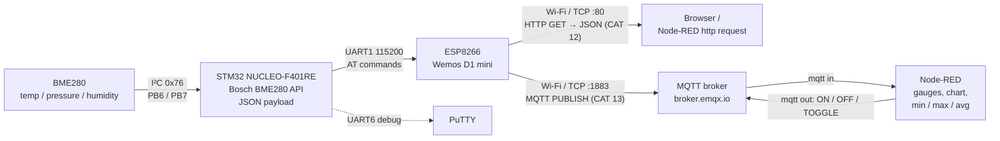

# FIoT Lab — 8051 and STM32 Embedded / IoT Experiments

[](https://github.com/vich2601-blip/FIoT-Lab-25CS2741/actions/workflows/build.yml) 

Lab work for **25CS2741 Fundamentals of Internet of Things + Lab** — B.Tech CSE (IoT), Semester 3, Shiv Nadar University Chennai.

The work goes from register-level C on the **8051**, to **STM32** with CubeMX and the HAL, and ends with a networked sensor node: an STM32 reads a **BME280** over I²C and shares the data over Wi-Fi through an **ESP8266**, first as an **HTTP/JSON** server and then over **MQTT** into **Node-RED**.

Every experiment folder has a `README.md` with the experiment details, a **circuit diagram drawn on Wokwi**, the working principle, pseudocode, the code base and the inference.

## 8051 (AT89S52) — Keil µVision, bare-metal C

| CAT | Experiment | Concepts | Folder |
|---|---|---|---|
| 2 | Tool chain, bare-metal blink, delay library | `sbit` SFR access, calibrated loops, `delay_ms()` | [CAT02](8051/CAT02_LED_Blink_and_Delay_Library/) |
| 3 | Four-state LED pattern generator | state machine, debouncing, edge detection | [CAT03](8051/CAT03_Button_LED_Pattern_Generator/) |
| 4 | Keypad + seven-segment + LED HMI | row scanning, look-up tables, required function split | [CAT04](8051/CAT04_Keypad_7Segment_HMI/) |
| 5 | Timer interrupts: 1 s base, PWM fade, square waves, signal patterns, stepper | Timer 0 Mode 1/2, ISR time base, software PWM | [CAT05](8051/CAT05_Timer_Interrupts_PWM_Stepper/) |
| 6 | UART driver, echo, interrupt RX ring buffer | SCON, Timer-1 baud, TI/RI, serial ISR | [CAT06](8051/CAT06_UART_Driver_Serial_Debugging/) |
| 7 | 16×2 LCD driver, live values, keypad-moved cursor | HD44780 4-bit init, DDRAM addressing | [CAT07](8051/CAT07_LCD_16x2_Driver/) |

## STM32 — STM32CubeMX + STM32CubeIDE, HAL

| CAT | Experiment | Board | Concepts | Folder |
|---|---|---|---|---|
| 8 | GPIO bring-up, debounce, short/long press | Blue Pill F103C6 | pull-ups, `HAL_GetTick()` time stamps | [CAT08](STM32/CAT08_GPIO_Button_LED/) |
| 9 | UART echo and text commands | Blue Pill F103C6 | USART2, line parsing, CR/LF | [CAT09](STM32/CAT09_UART_Command_LED/) |
| 10 | ESP8266 AT commands, Wi-Fi join, HTTP server | Blue Pill F103C8 + Wemos | two UARTs, AT protocol, `+IPD`, CIPSEND | [CAT10](STM32/CAT10_Wemos_WiFi_AT_Commands/) |
| 11 | Cortex-M4 GPIO, clock check, press classes | NUCLEO-F401RE | HSE bypass, PLL 84 MHz | [CAT11](STM32/CAT11_GPIO_User_Input/) |
| 12 | BME280 + HTTP JSON + Node-RED statistics | NUCLEO-F401RE | I²C, Bosch API, JSON, Content-Length | [CAT12](STM32/CAT12_BME280_I2C_HTTP_NodeRED/) |
| 13 | BME280 + MQTT + Node-RED dashboard | NUCLEO-F401RE | MQTT CONNECT/PUBLISH/SUBSCRIBE | [CAT13](STM32/CAT13_BME280_MQTT_NodeRED/) |

## System architecture (final experiments)



## Skills demonstrated

| Area | Where |
|---|---|
| Bare-metal register programming (SFRs, `sbit`, no libraries) | CAT 2 – 4 |
| Hardware timers and interrupt service routines, software PWM | CAT 5, 6 |
| Device drivers written from datasheets (UART, HD44780 LCD) | CAT 6, 7 |
| Debouncing and non-blocking state machines | CAT 3, 8, 11 |
| STM32CubeMX configuration, clock trees, HAL | CAT 8 – 13 |
| UART protocols, ring buffers, interrupt-driven receive | CAT 6C, 10D, 12B |
| I²C sensor integration with a vendor API | CAT 12, 13 |
| ESP8266 AT command interface, TCP server, raw HTTP | CAT 10, 12 |
| MQTT CONNECT / PUBLISH / SUBSCRIBE packets | CAT 13 |
| Node-RED flows, dashboards and statistics | CAT 12, 13 |
| Build automation and CI | `tools/build_all.sh`, GitHub Actions |

## Verification status

| What | How it was checked | Result |
|---|---|---|
| All 17 STM32 projects | compiled and linked with `arm-none-eabi-gcc` (`tools/build_all.sh`, GitHub Actions) | 0 errors; 0 warnings with `-Wall -Wextra` in the application code (`Core/`). Vendor HAL drivers are compiled with warnings off (`-w`), as is usual for vendor code — see [`docs/build-log.txt`](docs/build-log.txt) |
| All 15 8051 projects | compiled with SDCC from the Keil sources (keywords mapped on a temporary copy) | 0 errors; committed HEX files match the sources. SDCC is not Keil C51 — Keil output is not verified here |
| MQTT client (CAT 13) | host-side unit tests (`make -C tests`, ASan + UBSan, run in CI) | 54 packet checks + 56 ESPLib checks + 26 AT-driver checks against a simulated ESP8266 and broker, including fault injection (refused UART re-arm, malformed `+IPD` frames, RX overflow), plus a CI check that every project copy of a shared library matches its master: both CIPSEND reply styles, PINGRESP timeout, UNSUBACK, QoS-0-only rules, malformed and non-canonical packets, packets split across or combined in TCP chunks, wrong ACK ids, RX overflow mid-packet with clean TCP + MQTT reconnect, CONNACK Session Present rules, wildcard topics, NULL arguments, discarded over-long AT lines, link closing during CIPSEND |
| 8051 timing | measured in the uCsim 8051 simulator at 11.0592 MHz (SDCC code) | CAT 2 blink 1.000 s, `delay_ms()` 1.000 ms, CAT 5 timer toggle 0.999 s, 100 Hz mode 100.2 Hz |
| Node-RED flows | JSON structure and wiring validated, function code syntax-checked | valid |
| Memory use | linker output | largest Blue Pill build 7.9 KB of 32 KB flash; largest Nucleo build 33 KB of 512 KB |
| Behaviour on real hardware | to be recorded in each experiment's **Observation** table | pending |

## Hardware

| Part | Used in | Notes |
|---|---|---|
| AT89S52 development kit | CAT 2–7 | 11.0592 MHz, on-board LED P1.0 (active-low), keypad, 7-segment, 16×2 LCD, USBasp ISP |
| STM32 Blue Pill (F103C6 / F103C8) | CAT 8–10 | 8 MHz crystal → 72 MHz, LED PC13 (active-low), ST-LINK V2 over SWD |
| NUCLEO-F401RE | CAT 11–13 | 8 MHz from ST-LINK (HSE bypass) → 84 MHz, LD2 PA5, B1 PC13 |
| Wemos D1 mini (ESP8266) | CAT 10, 12, 13 | Espressif AT firmware, 115200 baud |
| Bosch BME280 | CAT 12, 13 | I²C address 0x76 |
| USB-to-TTL converter | CAT 6, 9, 10, 12, 13 | PuTTY terminal |
| ULN2003 + 28BYJ-48 | CAT 5 (optional task) | stepper motor |

## Tools

| Tool | Purpose |
|---|---|
| Keil µVision 5 (C51) | 8051 projects (`.uvproj`) |
| progisp + USBasp | flashing the AT89S52 |
| STM32CubeIDE / CubeMX | STM32 projects (`.ioc`, `.project`, `.cproject`) |
| Bosch BME280 Sensor API v3.5.1 | sensor driver (CAT 12, 13) |
| ESPLib API (reimplemented, MIT) | ESP8266 + MQTT client (CAT 13) |
| PuTTY, Node-RED | terminal, dashboards / analytics |

## Repository layout

```
8051/CATxx_<name>/
├── README.md, circuit.png, wokwi/ (diagram.json + custom chips)
└── <Task folder>/   main.c, libraries (delay, uart, lcd), STARTUP.A51, *.uvproj
STM32/CATxx_<name>/
├── README.md, circuit.png, wokwi/, dataflow.svg, Node-RED flows (CAT 12, 13)
└── <Project>/       Core/ (Src, Inc, Startup), Drivers/, *.ioc, .project, .cproject, *.ld
Common_Libraries/    BME280 API, ESP8266 AT driver, ESPLib MQTT client (rewrite), helpers
```

## Building

**8051:** flash the ready `Objects/*.hex` with progisp, or open the task's `.uvproj` in Keil µVision → **Build (F7)** to rebuild it. (Included HEX files were built with SDCC 4.6 and timing-checked in the uCsim simulator — see `8051/README.md`.)

**STM32:** STM32CubeIDE → **File → Import → General → Existing Projects into Workspace** → select the project folder → **Build** → **Run → Debug As → STM32 C/C++ Application**. Wi-Fi projects (CAT 10C, 10D, 12B, 13) read the network name and password from `Core/Inc/wifi_secrets.h`, which is git-ignored so credentials are never committed. Create it next to `wifi_config.h` with `#define WIFI_SSID "..."` and `#define WIFI_PASSWORD "..."`; without it the project builds with placeholders.

**Node-RED:** Menu → Import → choose the `NodeRED_*.json` file → Deploy.

## Notes

* Application code sits inside CubeMX `USER CODE` blocks, so *Generate Code* in CubeMX keeps it.
* Floats are printed with integer maths (`fmt_fixed.h`) because newlib-nano has no `%f` by default.
* Every project builds from the command line: `tools/build_all.sh` (also run by GitHub Actions on every push). `docs/build-log.txt` is simply the output of that script, run locally on macOS with the GCC that ships with STM32CubeIDE and SDCC 4.6; `UPDATE_HEX=1 tools/build_all.sh 8051` refreshes the committed HEX files.
* Host-side tests: `make -C tests` (MQTT packet parser, ESPLib and the ESP8266 AT driver against a simulated ESP8266).
* Maintaining the duplicated libraries, HEX files and build log: see [`CONTRIBUTING.md`](CONTRIBUTING.md).

## Licence

Original work: MIT — see [`LICENSE`](LICENSE). Third-party components keep their own licences — see [`THIRD_PARTY_NOTICES.md`](THIRD_PARTY_NOTICES.md).

## Third-party code

STM32Cube HAL / CMSIS (STMicroelectronics), Bosch Sensortec BME280_SensorAPI (BSD-3-Clause), Keil `STARTUP.A51`. The CAT 13 MQTT client keeps the function names of the course ESPLib (by Can Güveren) but is an independent implementation — see [`THIRD_PARTY_NOTICES.md`](THIRD_PARTY_NOTICES.md).
