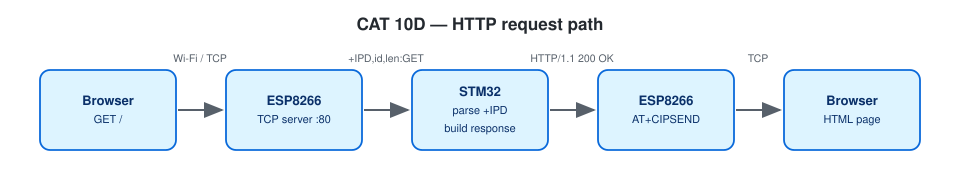

# EXPERIMENT DETAILS

**EXP:** CONTINUOUS ASSESSMENT 10

**DATE:** 05/10/2026 (Tasks 10C/10d: 12/10/2026)

**NAME OF EXP:** STM32–Wemos Wi-Fi Modem Interface Using AT Commands + HTTP Server

**HARDWARE SETUP / PLATFORM:** Blue Pill STM32F103C8T6 (Cortex-M3, 72 MHz) + Wemos D1 mini (ESP8266 AT firmware) + USB-to-TTL — STM32CubeMX + Keil MDK-ARM (STM32CubeIDE project also included), STM32 HAL, PuTTY

---

## TASK 9C : Connect Wemos to Wi-Fi

> The CAT 10 lab sheet numbers this task **9C**; it is stored in folder `TASK10C`.

### 1. Circuit Diagram

| STM32 | Connected to | Purpose |
|---|---|---|
| PA9 USART1_TX | Wemos RX | AT commands |
| PA10 USART1_RX | Wemos TX | responses |
| PA2 USART2_TX / PA3 USART2_RX | USB-to-TTL RX / TX | PC terminal |
| GND | all GNDs | common ground |

Both UARTs 115200-8-N-1. Wi-Fi credentials go in `Core/Inc/wifi_secrets.h` (git-ignored; see `wifi_config.h` for the format).


*Drawn on [Wokwi](https://wokwi.com). To open and edit it: start a new project on wokwi.com, paste [`wokwi/diagram.json`](wokwi/diagram.json) into its diagram.json tab, and add the `wokwi/*.chip.json` files (if any) with **New file**. The AT89S52, USB-TTL, ULN2003, USBasp and ST-LINK boards are custom chips (pin names added as labels). The ESP-01 part stands in for the Wemos D1 mini and the BMP180 module for the BME280 (same AT firmware / same 4-pin I²C header); the Nucleo-64 graphic is labelled as the F401RE.*



### 2. Core Logic / Pseudocode / Code Base

**Working Principle:**

Station mode → `AT+CWJAP` → `AT+CIFSR`; the IP and MAC are cut out of `STAIP,"…"` and `STAMAC,"…"`. As an extra, `AT+CIPSTART` + `AT+CIPSEND` send an HTTP GET to example.com and print the status line.

**Pseudocode:**

1. Initialise the ESP.
2. `AT+CWMODE=1`.
3. `AT+CWJAP` (20 s timeout).
4. On success parse and print IP and MAC.
5. TCP demo: CIPSTART → CIPSEND → wait `>` → request → print `HTTP/1.1 200 OK`.

**Code Base:**

- Project files: `CAT10C_Connect_Wemos_to_WiFi.ioc` (CubeMX configuration), `MDK-ARM/CAT10C_Connect_Wemos_to_WiFi.uvprojx` (Keil MDK), `.project` / `.cproject` (STM32CubeIDE); application code in `Core/Src/main.c`.
- `extract_after()`
- `esp_wait_prompt()`, `tcp_demo()`

**Expected Output:**

```
Connected to Wifi Successfully
IP Address : 192.168.x.x
MAC Address: xx:xx:xx:xx:xx:xx
Server replied: HTTP/1.1 200 OK
```

### 3. Inference

The ESP8266 joined the network under STM32 control and a TCP exchange was completed with CIPSTART/CIPSEND.
