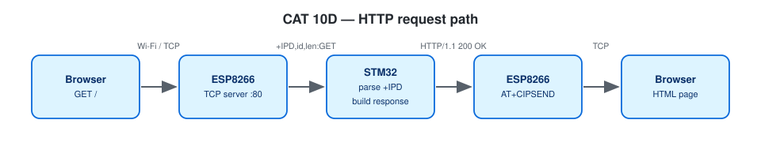

# EXPERIMENT DETAILS

**EXP:** CONTINUOUS ASSESSMENT 10

**DATE:** 05/10/2026 (Tasks 10C/10d: 12/10/2026)

**NAME OF EXP:** STM32–Wemos Wi-Fi Modem Interface Using AT Commands + HTTP Server

**HARDWARE SETUP / PLATFORM:** Blue Pill STM32F103C8T6 (Cortex-M3, 72 MHz) + Wemos D1 mini (ESP8266 AT firmware) + USB-to-TTL — STM32CubeMX + Keil MDK-ARM (STM32CubeIDE project also included), STM32 HAL, PuTTY

---

## TASK 10C / 10D : Configure ESP8266 as a TCP Server, HTTP Response

### 1. Circuit Diagram

| STM32 | Connected to | Purpose |
|---|---|---|
| PA9 USART1_TX | Wemos RX | AT commands |
| PA10 USART1_RX | Wemos TX | responses |
| PA2 USART2_TX / PA3 USART2_RX | USB-to-TTL RX / TX | PC terminal |
| GND | all GNDs | common ground |

Both UARTs 115200-8-N-1. Wi-Fi credentials go in `Core/Inc/wifi_secrets.h` (git-ignored; see `wifi_config.h` for the format).


*Drawn on [Wokwi](https://wokwi.com). To open and edit it: start a new project on wokwi.com, paste [`wokwi/diagram.json`](wokwi/diagram.json) into its diagram.json tab, and add the `wokwi/*.chip.json` files (if any) with **New file**. The AT89S52, USB-TTL, ULN2003, USBasp and ST-LINK boards are custom chips (pin names added as labels). The ESP-01 part stands in for the Wemos D1 mini and the BMP180 module for the BME280 (same AT firmware / same 4-pin I²C header); the Nucleo-64 graphic is labelled as the F401RE.*



### 2. Core Logic / Pseudocode / Code Base

**Working Principle:**

`AT+CIPMUX=1` and `AT+CIPSERVER=1,80` make the ESP8266 a TCP server. A browser request arrives as `+IPD,<id>,<len>:GET /path HTTP/1.1`. The USART1 RX interrupt fills a ring buffer (`esp_at.c`); unsolicited lines go to `on_esp_event()`, which stores the path per link. The main loop builds

```
HTTP/1.1 200 OK
Content-Type: text/html
Content-Length: <strlen(body)>
Connection: close

<html><body><h1>STM32 IoT Node</h1>...</body></html>
```
and sends it in two steps: `AT+CIPSEND=<id>,<len>` → wait for `>` → raw bytes → `SEND OK` → `AT+CIPCLOSE=<id>`. `/led/on` and `/led/off` switch PC13.

**Pseudocode:**

1. Startup, join Wi-Fi, start the server, print the URL.
2. Main loop: process ESP lines (URCs → `on_esp_event()`).
3. For each pending link: build the page or a 404 and send it.
4. On `WIFI DISCONNECT` wait for reconnection and restart the server.

**Code Base:**

- Project files: `CAT10D_HTTP_Server_Static_Page.ioc` (CubeMX configuration), `MDK-ARM/CAT10D_HTTP_Server_Static_Page.uvprojx` (Keil MDK), `.project` / `.cproject` (STM32CubeIDE); application code in `Core/Src/main.c`.
- `esp_at.c/.h` — interrupt ring buffer, timeouts, `esp_at_send()`
- USART1 global interrupt enabled (`stm32f1xx_it.c`, `stm32f1xx_hal_msp.c`, `.ioc`)
- `handle_request()`, `http_send()`

**Expected Output:**

```
Server running: http://192.168.x.x/
[HTTP] link 0  GET /
[HTTP] link 1  GET /favicon.ico
```

### 3. Inference

The STM32 itself builds a valid HTTP response from the +IPD request and serves it to a browser through the ESP8266.
