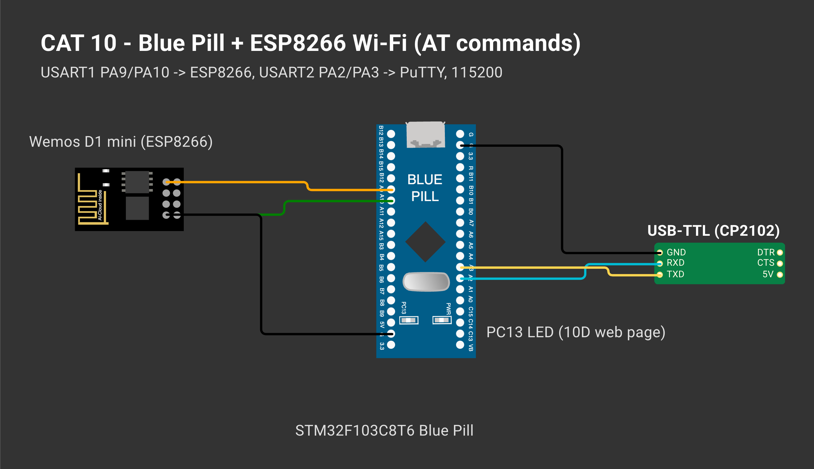
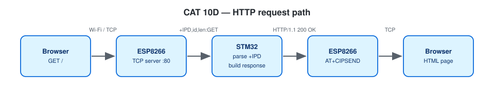

# CAT 10 — STM32 ↔ Wemos (ESP8266) Wi-Fi Modem Using AT Commands

| Field | Details |
|---|---|
| Experiment | Continuous Lab Evaluation 10 |
| Date | Week 9 / 10C: 12/10 (Week 10) |
| Experiment name | STM32–Wemos Wi-Fi Modem Interface Using AT Commands + HTTP Server |
| Platform | Blue Pill STM32F103C8T6 (Cortex-M3, 72 MHz) + Wemos D1 mini (ESP8266 AT firmware) + USB-to-TTL |
| Tools | STM32CubeMX + STM32CubeIDE, STM32 HAL, PuTTY |

## Circuit Diagram



*Drawn on [Wokwi](https://wokwi.com). To open and edit it: start a new project on wokwi.com, paste [`wokwi/diagram.json`](wokwi/diagram.json) into its diagram.json tab, and add the `wokwi/*.chip.json` files (if any) with **New file**. The AT89S52, USB-TTL, ULN2003, USBasp and ST-LINK boards are custom chips (pin names added as labels). The ESP-01 part stands in for the Wemos D1 mini and the BMP180 module for the BME280 (same AT firmware / same 4-pin I²C header); the Nucleo-64 graphic is labelled as the F401RE.*



| STM32 | Connected to | Purpose |
|---|---|---|
| PA9 USART1_TX | Wemos RX | AT commands |
| PA10 USART1_RX | Wemos TX | responses |
| PA2 USART2_TX / PA3 USART2_RX | USB-to-TTL RX / TX | PC terminal |
| GND | all GNDs | common ground |

Both UARTs 115200-8-N-1. Wi-Fi credentials go in `Core/Inc/wifi_secrets.h` (git-ignored; see `wifi_config.h` for the format).

---

## Task 10A — Establish STM32 ↔ Wemos UART Communication

**Project folder:** [`CAT10A_STM32_Wemos_UART_Link`](CAT10A_STM32_Wemos_UART_Link/)

### Working principle
After a 2 s boot wait the STM32 sends `AT`, collects reply lines until `OK`/`ERROR`/`FAIL` (with a timeout) and prints them. It then enters a bridge mode that forwards PuTTY ↔ ESP8266 so other commands can be tried by hand.

### Pseudocode
1. Banner on USART2.
2. `esp_startup()`: wait, retry `AT` up to 3 times, `ATE0`.
3. `at_show("AT")` → prints `>> AT`, `<< OK`.
4. `at_bridge_start()`: both UARTs switch to interrupt-driven receive, each into its own ring buffer (256 slots, 255 usable bytes); if re-arming the receive interrupt ever fails, the main loop retries it.
5. Loop: `at_bridge_poll()` forwards everything that has arrived in batches (CR from PuTTY → CR LF to the ESP) and reports lost bytes and transmit failures, so typing and long ESP replies do not drop characters.

### Code base
- `esp_read_line()` — line reader with timeout
- `at_command()` — collect until status line
- `at_show()` — print command and replies

### Expected output
```
STM32-WiFi MODEM TEST  (CAT10A)
ESP8266 answered, echo off
>> AT
<< OK
```

### Inference
The Wemos replies OK, so the two boards communicate; a separate UART keeps debug output away from AT traffic.

---

## Task 10B — Explore the ESP8266 AT Command Interface

**Project folder:** [`CAT10B_ESP8266_AT_Command_Explorer`](CAT10B_ESP8266_AT_Command_Explorer/)

### Working principle
Every command is a CR LF-terminated line and every reply ends with a status line.

| Requirement | Command |
|---|---|
| Modem response | `AT` |
| Firmware | `AT+GMR` |
| Station mode | `AT+CWMODE=1` |
| Scan | `AT+CWLAP` |
| Join AP | `AT+CWJAP="ssid","pwd"` |
| Network info | `AT+CIFSR` |
| TCP connection | `AT+CIPSTART="TCP","host",port` |
| Send data | `AT+CIPSEND=<len>` |

### Pseudocode
1. Startup as 10A.
2. For AT, AT+GMR, AT+CWMODE=1, AT+CWLAP: print, send, collect, print replies.
3. Print the requirement table.
4. Bridge mode.

### Code base
- Replies are buffered (1 KB) before printing so no ESP byte is lost while PuTTY is written

### Expected output
```
>> AT+GMR
<< AT version:...
<< SDK version:...
<< OK
>> AT+CWLAP
<< +CWLAP:(3,"SNUC",-58,...)
<< OK
```

### Inference
One request/response routine is enough to check the modem, read its firmware, set station mode and scan networks.

---

## Task 10C — Connect Wemos to Wi-Fi

**Project folder:** [`CAT10C_Connect_Wemos_to_WiFi`](CAT10C_Connect_Wemos_to_WiFi/)

### Working principle
Station mode → `AT+CWJAP` → `AT+CIFSR`; the IP and MAC are cut out of `STAIP,"…"` and `STAMAC,"…"`. As an extra, `AT+CIPSTART` + `AT+CIPSEND` send an HTTP GET to example.com and print the status line.

### Pseudocode
1. Initialise the ESP.
2. `AT+CWMODE=1`.
3. `AT+CWJAP` (20 s timeout).
4. On success parse and print IP and MAC.
5. TCP demo: CIPSTART → CIPSEND → wait `>` → request → print `HTTP/1.1 200 OK`.

### Code base
- `extract_after()`
- `esp_wait_prompt()`, `tcp_demo()`

### Expected output
```
Connected to Wifi Successfully
IP Address : 192.168.x.x
MAC Address: xx:xx:xx:xx:xx:xx
Server replied: HTTP/1.1 200 OK
```

### Inference
The ESP8266 joined the network under STM32 control and a TCP exchange was completed with CIPSTART/CIPSEND.

---

## Task 10C/10D — HTTP Server (Static Page)

**Project folder:** [`CAT10D_HTTP_Server_Static_Page`](CAT10D_HTTP_Server_Static_Page/)

### Working principle
`AT+CIPMUX=1` and `AT+CIPSERVER=1,80` make the ESP8266 a TCP server. A browser request arrives as `+IPD,<id>,<len>:GET /path HTTP/1.1`. The USART1 RX interrupt fills a ring buffer (`esp_at.c`); unsolicited lines go to `on_esp_event()`, which stores the path per link. The main loop builds

```
HTTP/1.1 200 OK
Content-Type: text/html
Content-Length: <strlen(body)>
Connection: close

<html><body><h1>STM32 IoT Node</h1>...</body></html>
```
and sends it in two steps: `AT+CIPSEND=<id>,<len>` → wait for `>` → raw bytes → `SEND OK` → `AT+CIPCLOSE=<id>`. `/led/on` and `/led/off` switch PC13.

### Pseudocode
1. Startup, join Wi-Fi, start the server, print the URL.
2. Main loop: process ESP lines (URCs → `on_esp_event()`).
3. For each pending link: build the page or a 404 and send it.
4. On `WIFI DISCONNECT` wait for reconnection and restart the server.

### Code base
- `esp_at.c/.h` — interrupt ring buffer, timeouts, `esp_at_send()`
- USART1 global interrupt enabled (`stm32f1xx_it.c`, `stm32f1xx_hal_msp.c`, `.ioc`)
- `handle_request()`, `http_send()`

### Expected output
```
Server running: http://192.168.x.x/
[HTTP] link 0  GET /
[HTTP] link 1  GET /favicon.ico
```

### Inference
The STM32 itself builds a valid HTTP response from the +IPD request and serves it to a browser through the ESP8266.
