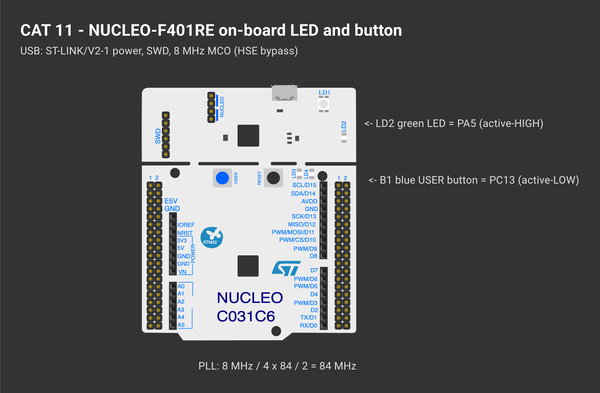

# CAT 11 — STM32F401RE Cortex-M4: GPIO and User Input Programming

| Field | Details |
|---|---|
| Experiment | Continuous Lab Evaluation 11 |
| Date | 14/10 (Week 11) |
| Experiment name | STM32F401RE Cortex-M4: GPIO and User Input Programming |
| Platform | NUCLEO-F401RE (STM32F401RET6, Cortex-M4F, 84 MHz) |
| Tools | STM32CubeMX + STM32CubeIDE, STM32 HAL |

## Circuit Diagram

*Drawn on [Wokwi](https://wokwi.com). To open and edit it: start a new project on wokwi.com, paste [`wokwi/diagram.json`](wokwi/diagram.json) into its diagram.json tab, and add the `wokwi/*.chip.json` files (if any) with **New file**. The AT89S52, USB-TTL, ULN2003, USBasp and ST-LINK boards are custom chips (pin names added as labels). The ESP-01 part stands in for the Wemos D1 mini and the BMP180 module for the BME280 (same AT firmware / same 4-pin I²C header); the Nucleo-64 graphic is labelled as the F401RE.*

| Item | Detail |
|---|---|
| Oscillator | no MCU crystal fitted; 8 MHz from the ST-LINK MCO → **HSE bypass** |
| Controller | STM32F401RET6, max 84 MHz, 512 KB flash, 96 KB SRAM |
| GPIO / UART / I²C / SPI | GPIOA-D, H / 3 USART (1, 2, 6) / 3 / 4 |
| CubeMX clock | 8 MHz ÷ 4 × 84 ÷ 2 = 84 MHz, APB1 42 MHz |
| LD2 | PA5, active-HIGH |
| B1 | PC13, active-LOW |

---

## Task 1 — On-board LED Bring-Up

**Project folder:** [`CAT11_Task1_LED_BringUp`](CAT11_Task1_LED_BringUp/)

### Working principle
`HAL_RCC_GetSysClockFreq()` checks the clock CubeMX configured. LD2 toggles every 500 ms (1 Hz) if SYSCLK is 84 MHz, or every 100 ms as a warning if not. Timing uses `HAL_GetTick()`.

### Pseudocode
1. Read SYSCLK and choose the blink period.
2. LD2 OFF.
3. If the period has passed, toggle PA5 and store the time.

### Code base
- `sysclk_hz` (Live Expressions), `blink_ms`

### Inference
LD2 blinks at a fixed rate, verifying the board, the 84 MHz clock tree and GPIO output.

---

## Task 2 — On-board Switch Control with State Remembrance

**Project folder:** [`CAT11_Task2_Button_Toggle_State_Memory`](CAT11_Task2_Button_Toggle_State_Memory/)

### Working principle
B1 is debounced (30 ms). Each press edge inverts `led_state` and writes it to LD2, so the LED keeps its new state after release.

### Pseudocode
1. Debounce B1.
2. On a press edge: `led_state = !led_state`, write LD2, count the press.

### Code base
- `debounce_update()`, `ld2_write()`, `led_state`, `press_count`

### Inference
The LED toggles once per valid press and remembers its state until the next press.

---

## Task 3 — Short-Press and Long-Press Detection

**Project folder:** [`CAT11_Task3_Short_Long_Press`](CAT11_Task3_Short_Long_Press/)

### Working principle
| Duration | Type | Action |
|---|---|---|
| < 30 ms | bounce | ignored |
| < 0.6 s | short | toggle LD2 |
| 0.6 – 3 s | long | blink mode ON/OFF |
| ≥ 3 s | very long | reset (LED off, blink off) |

Unsigned subtraction `now - press_start` stays correct across tick wrap-around. The press type is decided **on release**, so the action happens when the button is let go.

### Pseudocode
1. Press edge → store start.
2. Release edge → duration → `classify()`.
3. Act on the class.
4. In blink mode toggle every 150 ms.

### Code base
- `classify()`, `last_duration` (Live Expressions)

### Inference
The STM32 distinguishes three press lengths without blocking, so blinking and button reading run together.
