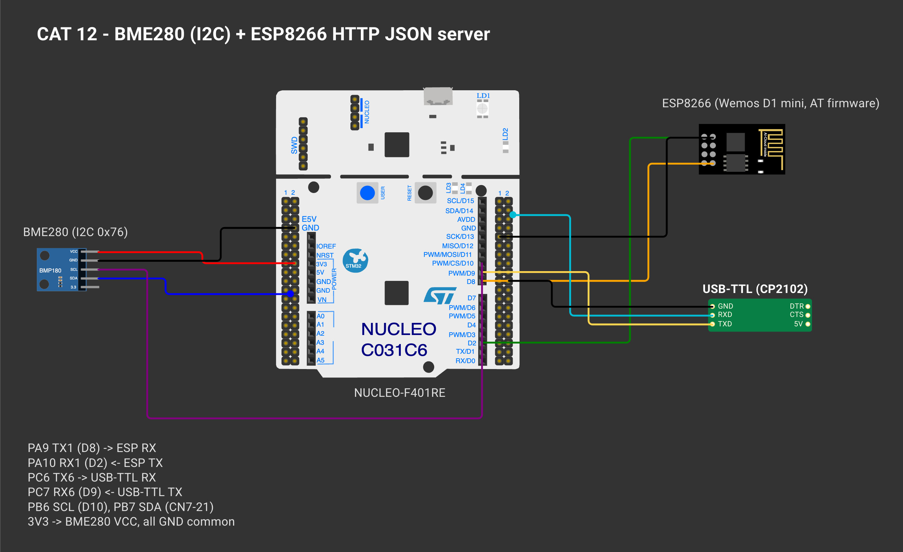
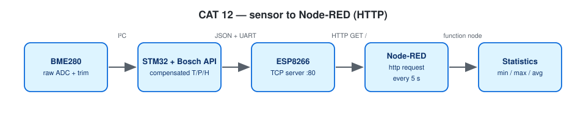

# EXPERIMENT DETAILS

**EXP:** CONTINUOUS ASSESSMENT 12

**DATE:** 23/10/2026

**NAME OF EXP:** BME280 Sensor Interfacing Using I²C and Bosch Sensor API, ESP8266 HTTP, Node Analytics

**HARDWARE SETUP / PLATFORM:** NUCLEO-F401RE (STM32F401RET6, Cortex-M4F, 84 MHz) + BME280 + Wemos D1 mini + USB-to-TTL — STM32CubeMX + Keil MDK-ARM (STM32CubeIDE project also included), STM32 HAL, Bosch BME280 Sensor API v3.5.1, Node-RED

---

## STEP 1–3 : BME280 Interfacing with the Bosch Sensor API

### 1. Circuit Diagram

| Nucleo | Connected to |
|---|---|
| PB6 I2C1_SCL / PB7 I2C1_SDA | BME280 SCL / SDA (100 kHz) |
| 3V3 / GND | BME280 VCC / GND, SDO → GND (address 0x76) |
| PA9 USART1_TX / PA10 USART1_RX | Wemos RX / TX (115200, RX interrupt) |
| PC6 USART6_TX / PC7 USART6_RX | USB-to-TTL (debug, 115200) |



*Drawn on [Wokwi](https://wokwi.com). To open and edit it: start a new project on wokwi.com, paste [`wokwi/diagram.json`](wokwi/diagram.json) into its diagram.json tab, and add the `wokwi/*.chip.json` files (if any) with **New file**. The AT89S52, USB-TTL, ULN2003, USBasp and ST-LINK boards are custom chips (pin names added as labels). The ESP-01 part stands in for the Wemos D1 mini and the BMP180 module for the BME280 (same AT firmware / same 4-pin I²C header); the Nucleo-64 graphic is labelled as the F401RE.*



### 2. Core Logic / Pseudocode / Code Base

**Working Principle:**

`bme280.c` goes in `Core/Src`, `bme280.h` + `bme280_defs.h` in `Core/Inc`. The Bosch driver calls three application functions through `bme280_dev`:

| API needs | Implemented as | HAL |
|---|---|---|
| read_register() | `user_i2c_read()` | `HAL_I2C_Mem_Read()` |
| write_register() | `user_i2c_write()` | `HAL_I2C_Mem_Write()` |
| delay_function() | `user_delay_us()` | `HAL_Delay()` for ≥ 1 ms, DWT cycle counter busy-wait for shorter delays |

The program follows the suggested progression: chip ID → raw registers → Bosch compensation → display → compare settings (Profile A 2×/filter off vs Profile B 16×/filter 16, switched every 10 readings).

**Pseudocode:**

1. Read register 0xD0 → must be 0x60, else halt with a wiring hint.
2. `bme_setup()`: fill `bme280_dev`, `bme280_init()`, set oversampling, filter, standby, normal mode.
3. Every 2 s: read 0xF7–0xFE and print the raw ADC values.
4. `bme280_get_sensor_data()` → T (°C), P (Pa → hPa), H (%RH) → print.
5. Every 10 readings switch profile.

**Code Base:**

- Project files: `CAT12A_BME280_I2C_UART.ioc` (CubeMX configuration), `MDK-ARM/CAT12A_BME280_I2C_UART.uvprojx` (Keil MDK), `.project` / `.cproject` (STM32CubeIDE); application code in `Core/Src/main.c`.
- `read_chip_id()`, `print_raw()`, `apply_profile()`, `bme_setup()`, `bme_read()`
- `fmt_fixed.h` — floats printed with integer maths (no `-u _printf_float` needed)

**Expected Output:**

```
Chip ID     : 0x60 (BME280 OK)
--- Reading 1 (profile A) ---
Raw ADC     : T=... P=... H=...
Temperature : 28.45 °C
Pressure    : 1008.72 hPa
Humidity    : 62.30 %RH
```

### 3. Inference

I²C communication, chip ID, configuration, raw reads and Bosch compensation were all demonstrated, and the values change when the sensor environment changes.
