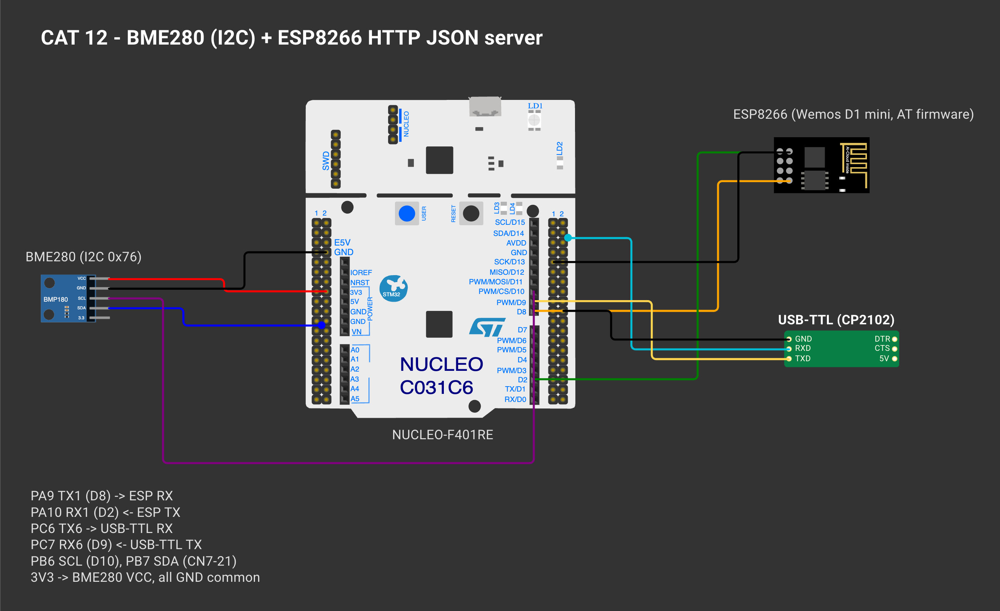
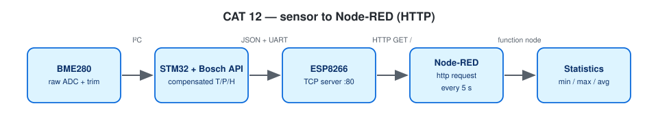

# EXPERIMENT DETAILS

**EXP:** CONTINUOUS ASSESSMENT 12

**DATE:** 23/10/2026

**NAME OF EXP:** BME280 Sensor Interfacing Using I²C and Bosch Sensor API, ESP8266 HTTP, Node Analytics

**HARDWARE SETUP / PLATFORM:** NUCLEO-F401RE (STM32F401RET6, Cortex-M4F, 84 MHz) + BME280 + Wemos D1 mini + USB-to-TTL — STM32CubeMX + Keil MDK-ARM (STM32CubeIDE project also included), STM32 HAL, Bosch BME280 Sensor API v3.5.1, Node-RED

---

## Raw HTTP Response with BME280 Data

### 1. Circuit Diagram

| Nucleo | Connected to |
|---|---|
| PB6 I2C1_SCL / PB7 I2C1_SDA | BME280 SCL / SDA (100 kHz) |
| 3V3 / GND | BME280 VCC / GND, SDO → GND (address 0x76) |
| PA9 USART1_TX / PA10 USART1_RX | Wemos RX / TX (115200, RX interrupt) |
| PC6 USART6_TX / PC7 USART6_RX | USB-to-TTL (debug, 115200) |



*Drawn on [Wokwi](https://wokwi.com). To open and edit it: start a new project on wokwi.com, paste [`wokwi/diagram.json`](wokwi/diagram.json) into its diagram.json tab, and add the `wokwi/*.chip.json` files (if any) with **New file**. The AT89S52, USB-TTL, ULN2003, USBasp and ST-LINK boards are custom chips (pin names added as labels). The ESP-01 part stands in for the Wemos D1 mini and the BMP180 module for the BME280 (same AT firmware / same 4-pin I²C header); the Nucleo-64 graphic is labelled as the F401RE.*



### 2. Core Logic / Pseudocode / Code Base

**Working Principle:**

The ESP8266 joins Wi-Fi and runs a TCP server on port 80 (shared `esp_at` driver). `GET /` returns JSON built from the latest compensated readings; the Content-Length is `strlen(json)`:

```
HTTP/1.1 200 OK
Content-Type: application/json
Content-Length: <calculated>
Access-Control-Allow-Origin: *
Connection: close

{"status":"success","temperature":28.45,"humidity":62.30,"pressure":1008.72}
```
Sensor reads happen every 2 s from time stamps rather than a delay. Sending a response is still a blocking AT+CIPSEND exchange (bounded by timeouts, a few tens of ms), so requests are served one after another.

**Pseudocode:**

1. Initialise the BME280.
2. Start the ESP8266, join Wi-Fi, start the server, print the URL.
3. Loop: handle URCs; answer each pending request (JSON or 404).
4. Every 2 s refresh the readings and print them.
5. Recover from `WIFI DISCONNECT`.

**Code Base:**

- Project files: `CAT12B_BME280_HTTP_JSON_Server.ioc` (CubeMX configuration), `MDK-ARM/CAT12B_BME280_HTTP_JSON_Server.uvprojx` (Keil MDK), `.project` / `.cproject` (STM32CubeIDE); application code in `Core/Src/main.c`.
- `build_json()`, `http_reply()`, `handle_request()`, `server_start()`

**Expected Output:**

```
{"status":"success","temperature":28.45,"humidity":62.30,"pressure":1008.72}
```

### 3. Inference

The STM32 constructs a correct raw HTTP response with a JSON body and a calculated Content-Length.

---

## NEXT STEP : Node-RED Statistics

### 1. Circuit Diagram

| Nucleo | Connected to |
|---|---|
| PB6 I2C1_SCL / PB7 I2C1_SDA | BME280 SCL / SDA (100 kHz) |
| 3V3 / GND | BME280 VCC / GND, SDO → GND (address 0x76) |
| PA9 USART1_TX / PA10 USART1_RX | Wemos RX / TX (115200, RX interrupt) |
| PC6 USART6_TX / PC7 USART6_RX | USB-to-TTL (debug, 115200) |


*Drawn on [Wokwi](https://wokwi.com). To open and edit it: start a new project on wokwi.com, paste [`wokwi/diagram.json`](wokwi/diagram.json) into its diagram.json tab, and add the `wokwi/*.chip.json` files (if any) with **New file**. The AT89S52, USB-TTL, ULN2003, USBasp and ST-LINK boards are custom chips (pin names added as labels). The ESP-01 part stands in for the Wemos D1 mini and the BMP180 module for the BME280 (same AT firmware / same 4-pin I²C header); the Nucleo-64 graphic is labelled as the F401RE.*


### 2. Core Logic / Pseudocode / Code Base

**Working Principle:**

`NodeRED_CAT12_HTTP_Statistics_flow.json`: inject (5 s) → http request (GET STM32 /, parsed JSON) → function (running min / max / sum / count in context) → debug as a table. A reset inject clears the statistics.

**Pseudocode:**

1. Import the flow, set the STM32 IP in the http request node, Deploy.
2. Let it collect readings, read the table in the Debug sidebar.

**Code Base:**

- `NodeRED_CAT12_HTTP_Statistics_flow.json`

**Expected Output:**

```
Parameter            Minimum  Maximum  Average
Temperature (°C)       27.91    29.02    28.46
Humidity (%RH)          59.8     64.2    62.15
Pressure (hPa)       1007.84  1009.31  1008.56
```

### 3. Inference

Node-RED turns the raw JSON stream into summary statistics without changing the firmware.
