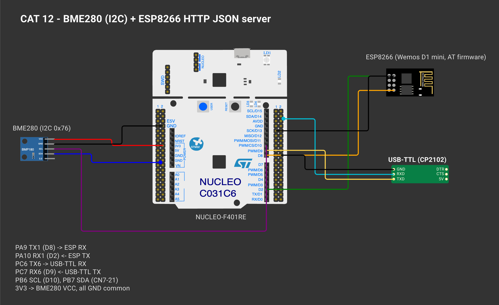
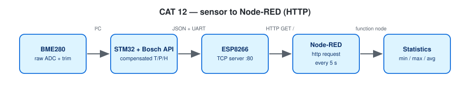

# CAT 12 — BME280 over I²C (Bosch API) → UART → HTTP JSON → Node-RED

| Field | Details |
|---|---|
| Experiment | Continuous Lab Evaluation 12 |
| Date | 23/10 (Week 12) |
| Experiment name | BME280 Sensor Interfacing Using I²C and Bosch Sensor API, ESP8266 HTTP, Node Analytics |
| Platform | NUCLEO-F401RE (STM32F401RET6, Cortex-M4F, 84 MHz) + BME280 + Wemos D1 mini + USB-to-TTL |
| Tools | STM32CubeMX + STM32CubeIDE, STM32 HAL, Bosch BME280 Sensor API v3.5.1, Node-RED |

## Circuit Diagram



*Drawn on [Wokwi](https://wokwi.com). To open and edit it: start a new project on wokwi.com, paste [`wokwi/diagram.json`](wokwi/diagram.json) into its diagram.json tab, and add the `wokwi/*.chip.json` files (if any) with **New file**. The AT89S52, USB-TTL, ULN2003, USBasp and ST-LINK boards are custom chips (pin names added as labels). The ESP-01 part stands in for the Wemos D1 mini and the BMP180 module for the BME280 (same AT firmware / same 4-pin I²C header); the Nucleo-64 graphic is labelled as the F401RE.*



| Nucleo | Connected to |
|---|---|
| PB6 I2C1_SCL / PB7 I2C1_SDA | BME280 SCL / SDA (100 kHz) |
| 3V3 / GND | BME280 VCC / GND, SDO → GND (address 0x76) |
| PA9 USART1_TX / PA10 USART1_RX | Wemos RX / TX (115200, RX interrupt) |
| PC6 USART6_TX / PC7 USART6_RX | USB-to-TTL (debug, 115200) |

---

## Step 1–3 — BME280 Interfacing with the Bosch Sensor API

**Project folder:** [`CAT12A_BME280_I2C_UART`](CAT12A_BME280_I2C_UART/)

### Working principle
`bme280.c` goes in `Core/Src`, `bme280.h` + `bme280_defs.h` in `Core/Inc`. The Bosch driver calls three application functions through `bme280_dev`:

| API needs | Implemented as | HAL |
|---|---|---|
| read_register() | `user_i2c_read()` | `HAL_I2C_Mem_Read()` |
| write_register() | `user_i2c_write()` | `HAL_I2C_Mem_Write()` |
| delay_function() | `user_delay_us()` | `HAL_Delay()` rounded up |

The program follows the suggested progression: chip ID → raw registers → Bosch compensation → display → compare settings (Profile A 2×/filter off vs Profile B 16×/filter 16, switched every 10 readings).

### Pseudocode
1. Read register 0xD0 → must be 0x60, else halt with a wiring hint.
2. `bme_setup()`: fill `bme280_dev`, `bme280_init()`, set oversampling, filter, standby, normal mode.
3. Every 2 s: read 0xF7–0xFE and print the raw ADC values.
4. `bme280_get_sensor_data()` → T (°C), P (Pa → hPa), H (%RH) → print.
5. Every 10 readings switch profile.

### Code base
- `read_chip_id()`, `print_raw()`, `apply_profile()`, `bme_setup()`, `bme_read()`
- `fmt_fixed.h` — floats printed with integer maths (no `-u _printf_float` needed)

### Expected output
```
Chip ID     : 0x60 (BME280 OK)
--- Reading 1 (profile A) ---
Raw ADC     : T=... P=... H=...
Temperature : 28.45 °C
Pressure    : 1008.72 hPa
Humidity    : 62.30 %RH
```

### Inference
I²C communication, chip ID, configuration, raw reads and Bosch compensation were all demonstrated, and the values change when the sensor environment changes.

---

## Raw HTTP Response with BME280 Data

**Project folder:** [`CAT12B_BME280_HTTP_JSON_Server`](CAT12B_BME280_HTTP_JSON_Server/)

### Working principle
The ESP8266 joins Wi-Fi and runs a TCP server on port 80 (shared `esp_at` driver). `GET /` returns JSON built from the latest compensated readings; the Content-Length is `strlen(json)`:

```
HTTP/1.1 200 OK
Content-Type: application/json
Content-Length: <calculated>
Access-Control-Allow-Origin: *
Connection: close

{"status":"success","temperature":28.45,"humidity":62.30,"pressure":1008.72}
```
Sensor reads happen every 2 s from time stamps rather than a delay. Sending a response is still a blocking AT+CIPSEND exchange (bounded by timeouts, a few tens of ms), so requests are served one after another.

### Pseudocode
1. Initialise the BME280.
2. Start the ESP8266, join Wi-Fi, start the server, print the URL.
3. Loop: handle URCs; answer each pending request (JSON or 404).
4. Every 2 s refresh the readings and print them.
5. Recover from `WIFI DISCONNECT`.

### Code base
- `build_json()`, `http_reply()`, `handle_request()`, `server_start()`

### Expected output
```
{"status":"success","temperature":28.45,"humidity":62.30,"pressure":1008.72}
```

### Inference
The STM32 constructs a correct raw HTTP response with a JSON body and a calculated Content-Length.

---

## Next Step — Node-RED Statistics

### Working principle
`NodeRED_CAT12_HTTP_Statistics_flow.json`: inject (5 s) → http request (GET STM32 /, parsed JSON) → function (running min / max / sum / count in context) → debug as a table. A reset inject clears the statistics.

### Pseudocode
1. Import the flow, set the STM32 IP in the http request node, Deploy.
2. Let it collect readings, read the table in the Debug sidebar.

### Code base
- `NodeRED_CAT12_HTTP_Statistics_flow.json`

### Expected output
```
Parameter            Minimum  Maximum  Average
Temperature (°C)       27.91    29.02    28.46
Humidity (%RH)          59.8     64.2    62.15
Pressure (hPa)       1007.84  1009.31  1008.56
```

### Inference
Node-RED turns the raw JSON stream into summary statistics without changing the firmware.
