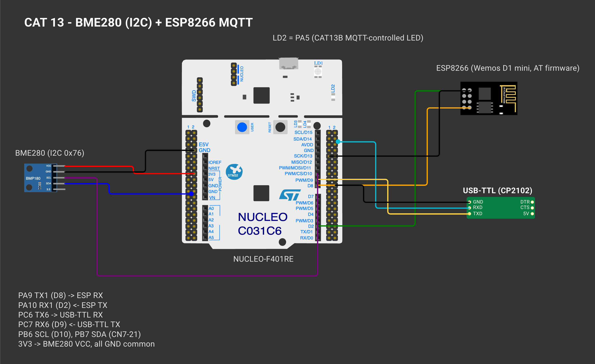
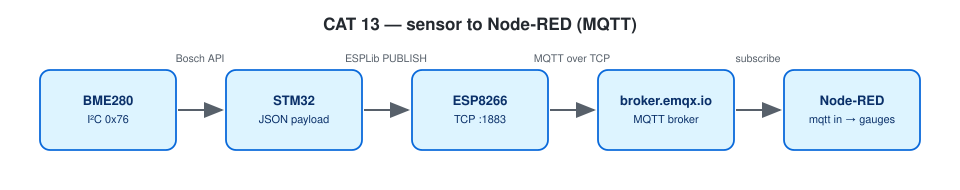

# EXPERIMENT DETAILS

**EXP:** CONTINUOUS ASSESSMENT 13

**DATE:** 27/10/2026

**NAME OF EXP:** BME280 Sensor Interfacing Using I²C and MQTT using Custom Built ESP8266 API

**HARDWARE SETUP / PLATFORM:** NUCLEO-F401RE (STM32F401RET6, Cortex-M4F, 84 MHz) + BME280 + Wemos D1 mini — STM32CubeMX + Keil MDK-ARM (STM32CubeIDE project also included), STM32 HAL, ESPLib API (reworked implementation), Node-RED, broker.emqx.io

---

## STEP 1–3 : Interface Wrappers (Publish Test)

### 1. Circuit Diagram

Same wiring as CAT 12; CAT13B also uses LD2 (PA5). Broker **broker.emqx.io:1883**.



*Drawn on [Wokwi](https://wokwi.com). To open and edit it: start a new project on wokwi.com, paste [`wokwi/diagram.json`](wokwi/diagram.json) into its diagram.json tab, and add the `wokwi/*.chip.json` files (if any) with **New file**. The AT89S52, USB-TTL, ULN2003, USBasp and ST-LINK boards are custom chips (pin names added as labels). The ESP-01 part stands in for the Wemos D1 mini and the BMP180 module for the BME280 (same AT firmware / same 4-pin I²C header); the Nucleo-64 graphic is labelled as the F401RE.*



### 2. Core Logic / Pseudocode / Code Base

**Working Principle:**

ESPLib joins Wi-Fi, opens TCP to the broker and sends CONNECT (keep-alive 120 s, clean session), then waits for CONNACK and only continues if the broker accepted the connection; if anything fails it retries every 5 s, and it reconnects if the link drops. Then `hello #n from STM32 Nucleo` is published to `vishrudh/stm32/test` every second.

**Pseudocode:**

1. `mqtt_start()`: Init → wifiConnect → portConnect → connectBroker.
2. Loop: format the message, `MQTT_publishTopic(..., QoS0)`, print, wait 1 s.

**Code Base:**

- Project files: `CAT13A_MQTT_Publish_Test.ioc` (CubeMX configuration), `MDK-ARM/CAT13A_MQTT_Publish_Test.uvprojx` (Keil MDK), `.project` / `.cproject` (STM32CubeIDE); application code in `Core/Src/main.c`.
- `mqtt_start()`, `dbg()`

**Expected Output:**

```
MQTT connected (CONNACK accepted) as stm32-vishrudh-test
PUB vishrudh/stm32/test : hello #1 from STM32 Nucleo
```

**Supporting notes:**

| ESPLib function | What it sends |
|---|---|
| `ESP8266_Init(StationMode, huart1)` | `AT`, `AT+CWMODE=1` |
| `ESP8266_wifiConnect()` | `AT+CWQAP`, `AT+CWJAP` |
| `ESP8266_portConnect("TCP", broker, "1883")` | `AT+CIPSTART` |
| `MQTT_connectBroker()` | CONNECT 0x10, "MQTT", level 4, clean session, keep-alive, client ID |
| `MQTT_publishTopic()` | PUBLISH 0x30, topic length, topic, payload |
| `MQTT_subscribeTopic()` | SUBSCRIBE 0x82 |

**Reworked library.** `ESPLib.h` keeps the course function names, so the lab-sheet code compiles unchanged, but `ESPLib.c` + `mqtt_packet.c` are a new implementation:

| Problem in the original | Now |
|---|---|
| RX interrupt aborted during every send, so packets arriving meanwhile were lost | RX interrupt armed once and never aborted; 1 KB ring buffer |
| Packet end guessed from 100 ms of UART silence; `colonIndex` could be used uninitialised (SUBACK / PINGRESP have no `:` structure) | `+IPD,<len>:` framing removed, then a byte-wise MQTT parser using the packet type and Remaining Length |
| 1-byte Remaining Length only, lengths and destination sizes not checked, strings not always terminated | Remaining Length up to 4 bytes, every length validated before copying, output always NUL-terminated, oversized packets skipped |
| CONNACK / SUBACK never checked; `do {} while` loops could hang forever | CONNECT waits for CONNACK = accepted, SUBSCRIBE for SUBACK ≠ 0x80; every wait has a timeout and returns `funcOk` / `funcErr` |

Also: PINGREQ waits for PINGRESP (no answer → reconnect), topics that do not fit the buffer are dropped and counted, and the applications print the RX-overflow / dropped-packet counters when they change.

The client is **QoS 0 only**: publish/subscribe calls asking for QoS 1/2 return `funcErr`, a SUBACK must grant QoS 0, and incoming QoS 1/2 messages (which would need PUBACK) are dropped and counted. UNSUBSCRIBE waits for the matching UNSUBACK.

If the UART ring buffer ever overflows, the buffered bytes are discarded, the parser is reset and both the TCP link and the MQTT session are marked down, so the board does a full reconnect instead of parsing a broken stream. A malformed `+IPD` frame takes the same full-recovery path, and if HAL ever refuses to re-arm UART reception the library retries from the main loop. CONNACK is also checked for the Session Present rules, and topics with wildcards are rejected.

Tested on the PC: `make -C tests` (54 parser checks + 56 ESPLib checks, including fault injection against a simulated ESP8266, including both `AT+CIPSEND` reply styles, packets split across and combined in TCP chunks, wrong ACK ids, a silent broker and an overflow in the middle of a packet).

### 3. Inference

MQTT runs on top of the ESP8266 TCP link; the STM32 only has to frame the packets.
