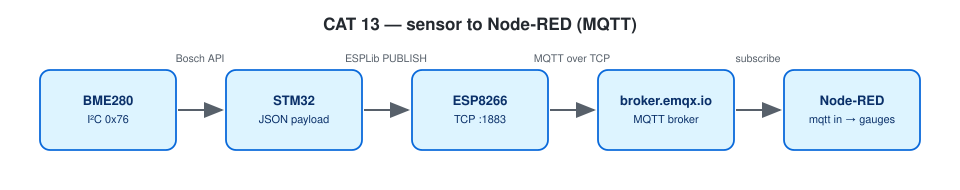

# CAT 13 — BME280 over I²C and MQTT using the Custom ESP8266 API → Node-RED

| Field | Details |
|---|---|
| Experiment | Continuous Lab Evaluation 13 |
| Date | 27/10 (Week 13) |
| Experiment name | BME280 Sensor Interfacing Using I²C and MQTT using Custom Built ESP8266 API |
| Platform | NUCLEO-F401RE (STM32F401RET6, Cortex-M4F, 84 MHz) + BME280 + Wemos D1 mini |
| Tools | STM32CubeMX + STM32CubeIDE, STM32 HAL, ESPLib API (reworked implementation), Node-RED, broker.emqx.io |

## Circuit Diagram


*Drawn on [Wokwi](https://wokwi.com). To open and edit it: start a new project on wokwi.com, paste [`wokwi/diagram.json`](wokwi/diagram.json) into its diagram.json tab, and add the `wokwi/*.chip.json` files (if any) with **New file**. The AT89S52, USB-TTL, ULN2003, USBasp and ST-LINK boards are custom chips (pin names added as labels). The ESP-01 part stands in for the Wemos D1 mini and the BMP180 module for the BME280 (same AT firmware / same 4-pin I²C header); the Nucleo-64 graphic is labelled as the F401RE.*



Same wiring as CAT 12; CAT13B also uses LD2 (PA5). Broker **broker.emqx.io:1883**.

| ESPLib function | What it sends |
|---|---|
| `ESP8266_Init(StationMode, huart1)` | `AT`, `AT+CWMODE=1` |
| `ESP8266_wifiConnect()` | `AT+CWQAP`, `AT+CWJAP` |
| `ESP8266_portConnect("TCP", broker, "1883")` | `AT+CIPSTART` |
| `MQTT_connectBroker()` | CONNECT 0x10, "MQTT", level 4, clean session, keep-alive, client ID |
| `MQTT_publishTopic()` | PUBLISH 0x30, topic length, topic, payload |
| `MQTT_subscribeTopic()` | SUBSCRIBE 0x82 |

**Reworked library.** `ESPLib.h` keeps the course function names, so the lab-sheet code compiles unchanged, but `ESPLib.c` + `mqtt_packet.c` are a new implementation:

| Problem in the original | Now |
|---|---|
| RX interrupt aborted during every send, so packets arriving meanwhile were lost | RX interrupt armed once and never aborted; 1 KB ring buffer |
| Packet end guessed from 100 ms of UART silence; `colonIndex` could be used uninitialised (SUBACK / PINGRESP have no `:` structure) | `+IPD,<len>:` framing removed, then a byte-wise MQTT parser using the packet type and Remaining Length |
| 1-byte Remaining Length only, lengths and destination sizes not checked, strings not always terminated | Remaining Length up to 4 bytes, every length validated before copying, output always NUL-terminated, oversized packets skipped |
| CONNACK / SUBACK never checked; `do {} while` loops could hang forever | CONNECT waits for CONNACK = accepted, SUBSCRIBE for SUBACK ≠ 0x80; every wait has a timeout and returns `funcOk` / `funcErr` |

Also: PINGREQ waits for PINGRESP (no answer → reconnect), topics that do not fit the buffer are dropped and counted, and the applications print the RX-overflow / dropped-packet counters when they change.

The client is **QoS 0 only**: publish/subscribe calls asking for QoS 1/2 return `funcErr`, a SUBACK must grant QoS 0, and incoming QoS 1/2 messages (which would need PUBACK) are dropped and counted. UNSUBSCRIBE waits for the matching UNSUBACK.

If the UART ring buffer ever overflows, the buffered bytes are discarded, the parser is reset and the session is marked down, so the board reconnects instead of parsing a broken stream.

Tested on the PC: `make -C tests` (47 parser checks + 43 ESPLib checks against a simulated ESP8266, including both `AT+CIPSEND` reply styles, packets split across and combined in TCP chunks, wrong ACK ids, a silent broker and an overflow in the middle of a packet).

---

## Step 1–3 — Interface Wrappers (Publish Test)

**Project folder:** [`CAT13A_MQTT_Publish_Test`](CAT13A_MQTT_Publish_Test/)

### Working principle
ESPLib joins Wi-Fi, opens TCP to the broker and sends CONNECT (keep-alive 120 s, clean session), then waits for CONNACK and only continues if the broker accepted the connection; if anything fails it retries every 5 s, and it reconnects if the link drops. Then `hello #n from STM32 Nucleo` is published to `vishrudh/stm32/test` every second.

### Pseudocode
1. `mqtt_start()`: Init → wifiConnect → portConnect → connectBroker.
2. Loop: format the message, `MQTT_publishTopic(..., QoS0)`, print, wait 1 s.

### Code base
- `mqtt_start()`, `dbg()`

### Expected output
```
MQTT connected (CONNACK accepted) as stm32-vishrudh-test
PUB vishrudh/stm32/test : hello #1 from STM32 Nucleo
```

### Inference
MQTT runs on top of the ESP8266 TCP link; the STM32 only has to frame the packets.

---

## Subscribe Example — LED Control

**Project folder:** [`CAT13B_MQTT_Subscribe_LED_Control`](CAT13B_MQTT_Subscribe_LED_Control/)

### Working principle
After CONNACK the board subscribes to `vishrudh/stm32/led` and checks the SUBACK. `MQTTDataHandler()` returns 1 when a complete, validated PUBLISH has arrived. Only the exact commands `ON` / `OFF` / `TOGGLE` act on LD2; anything else is ignored. PINGREQ every 60 s keeps the session alive; if the broker does not answer, the board reconnects and resubscribes. `MQTTTimer()` is still called from `SysTick_Handler` (the lab-sheet hook) but is no longer needed.

> **Security note:** broker.emqx.io is a public test broker — anyone who knows the topic can publish to it. For anything beyond a lab demo, use a private broker with a login: define `MQTT_USERNAME` / `MQTT_PASSWORD` in `wifi_secrets.h` and the client sends them in CONNECT.

### Pseudocode
1. LD2 init, `mqtt_start()`, `MQTT_subscribeTopic()`, `HAL_UART_Receive_IT()`.
2. Loop: `MQTTDataHandler()`; on a message print it and act on it.
3. Every 60 s `MQTT_pingReq()`.

### Code base
- `subscribe_commands()` — SUBSCRIBE + SUBACK check; reconnect + resubscribe in the main loop
- `handle_message()`

### Inference
The same library supports the reverse direction, so Node-RED or any client can control the board.

---

## Develop the Application — BME280 JSON over MQTT

**Project folder:** [`CAT13C_BME280_MQTT_NodeRED`](CAT13C_BME280_MQTT_NodeRED/)

### Working principle
The Bosch API is set up as in CAT 12. Every 2 s the readings are formatted as
`{"status":"success","temperature":28.45,"humidity":62.30,"pressure":1008.72}` and published to `vishrudh/stm32/bme280` with QoS 0.

### Pseudocode
1. Initialise the BME280 (2×, filter off, normal mode).
2. `mqtt_start()`.
3. Loop: read, `build_json()`, publish, print, wait 2 s.

### Code base
- `build_json()`, `bme_setup()`, `bme_read()`, `fmt_2dp()`

### Expected output
```
PUB vishrudh/stm32/bme280 {"status":"success","temperature":28.45,"humidity":62.30,"pressure":1008.72}
```

### Inference
Sensor data reaches any MQTT subscriber; the publisher does not need to know who receives it.

---

## Next Step — Node-RED

### Working principle
`NodeRED_CAT13_MQTT_flow.json`: **mqtt in** (Network palette, parsed JSON) → function splits temperature / humidity / pressure → debug, plus a statistics table and ON/OFF/TOGGLE injects → **mqtt out** for CAT13B.
`NodeRED_CAT13_Dashboard_flow.json`: three gauges and a trend chart (needs `node-red-dashboard`, open `/ui`).

### Pseudocode
1. Import a flow, Deploy.
2. Watch the debug values or the dashboard gauges update every 2 s.

### Code base
- `NodeRED_CAT13_MQTT_flow.json`
- `NodeRED_CAT13_Dashboard_flow.json`

### Inference
Node-RED subscribes with `mqtt in` and visualises the three BME280 parameters live.
