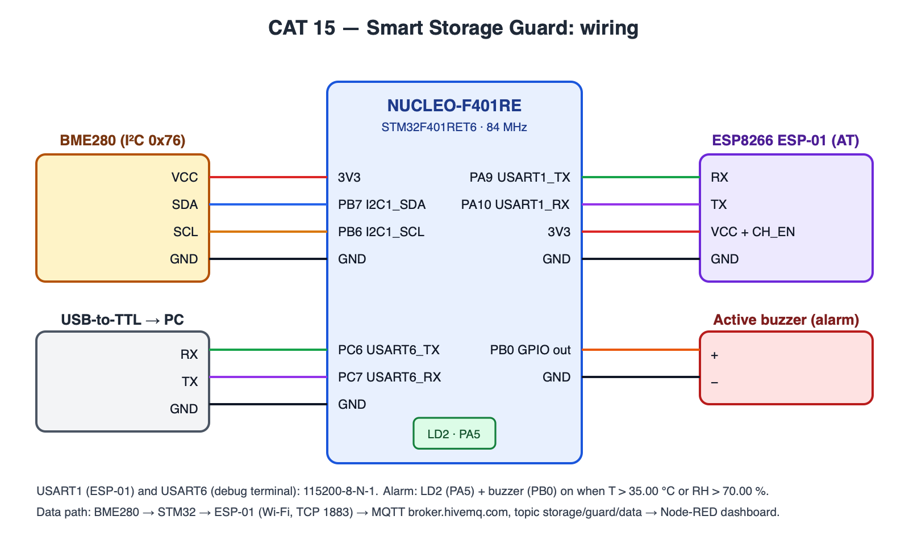
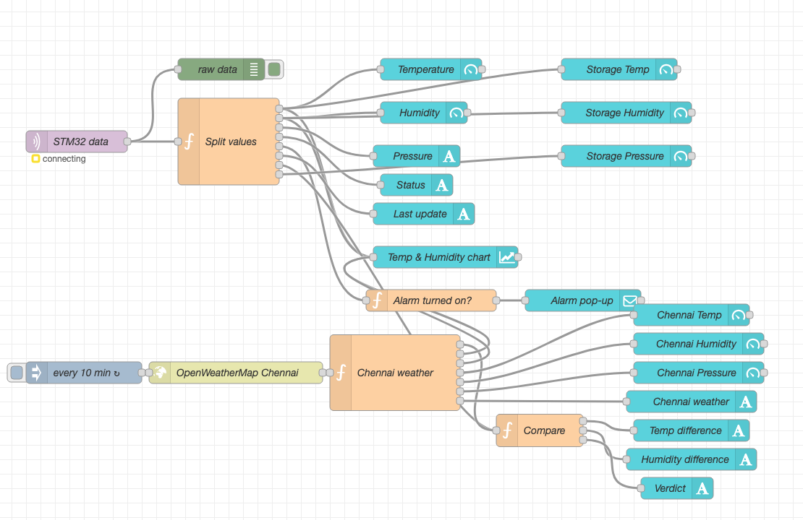
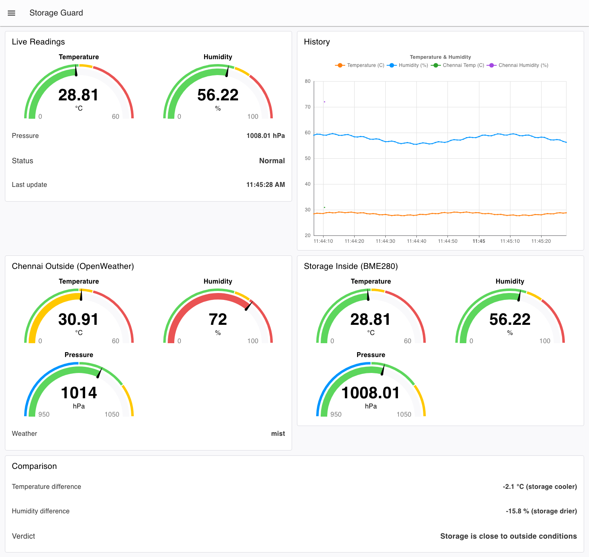
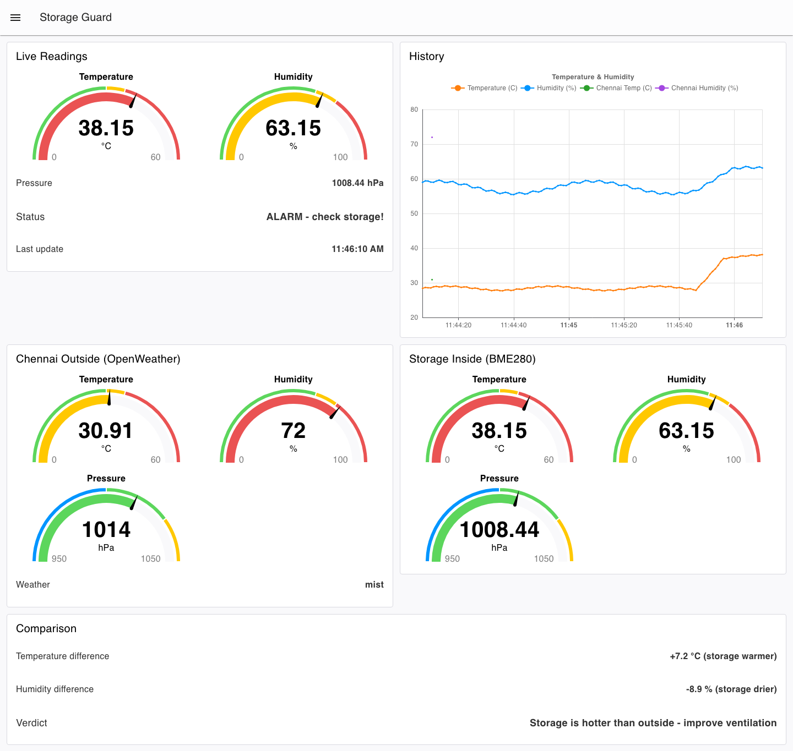

# EXPERIMENT DETAILS

**EXP:** CONTINUOUS ASSESSMENT 15 — PROJECT (Complete IoT Flow)

**DATE:** 14/11/2026 (Week 15 project submission)

**NAME OF EXP:** Smart Storage Guard — BME280 storage monitor with local alarm, MQTT and a Node-RED dashboard

**HARDWARE SETUP / PLATFORM:** NUCLEO-F401RE (STM32F401RET6, Cortex-M4F, 84 MHz) + BME280 (I²C) + ESP8266 ESP-01 (AT firmware) + active buzzer + USB-to-TTL — STM32CubeMX + Keil MDK-ARM (STM32CubeIDE project also included), STM32 HAL, MQTT (broker.hivemq.com), Node-RED + FlowFuse Dashboard 2.0, OpenWeatherMap API

---

## TASK 15 : Smart Storage Guard — Complete IoT Flow

A storage room (or cupboard / godown) is watched by a BME280. The STM32 reads temperature, humidity and pressure every second, switches a local alarm (LD2 + buzzer) when the limits are crossed, and publishes the readings as JSON over MQTT through the ESP-01. Node-RED subscribes, shows live gauges and a history chart, raises a pop-up when the alarm turns on, and compares the storage readings with the outside weather in Chennai from OpenWeatherMap.

### 1. Circuit Diagram

| STM32 (Nucleo) | Connected to | Purpose |
|---|---|---|
| 3V3 / GND | BME280 VCC / GND | sensor supply |
| PB7 I2C1_SDA / PB6 I2C1_SCL | BME280 SDA / SCL | I²C, address 0x76 (SDO → GND) |
| PA9 USART1_TX / PA10 USART1_RX | ESP-01 RX / TX | AT commands, MQTT over TCP |
| 3V3 / GND | ESP-01 VCC + CH_EN / GND | Wi-Fi module supply |
| PB0 (GPIO out) | active buzzer + (− to GND) | audible alarm |
| PA5 | on-board LED LD2 | visual alarm |
| PC6 USART6_TX / PC7 USART6_RX | USB-to-TTL RX / TX | debug terminal (PuTTY) |

USART1 and USART6 run at 115200-8-N-1. Wi-Fi credentials go in `Core/Inc/wifi_secrets.h` (git-ignored); `Core/Inc/esp8266.h` shows the two `#define`s it needs.



### 2. Core Logic / Pseudocode / Code Base

**Working Principle:**

1. **Sense** — `bme280.c` reads the factory calibration once, then every loop reads the raw ADC values over I²C and applies the Bosch integer compensation (T in 0.01 °C, RH in 0.01 %, P in 0.01 hPa). It also recognises a BMP280 (chip ID 0x58, no humidity).
2. **Decide locally** — alarm = `T > 35.00 °C` **or** `RH > 70.00 %`. The alarm drives LD2 (PA5) and the buzzer (PB0) immediately, so the storage is protected even when Wi-Fi is down.
3. **Connect** — `esp8266.c` uses only standard AT commands: `AT+CWMODE=1`, `AT+CWJAP` (Wi-Fi), `AT+CIPSTART="TCP","broker.hivemq.com",1883`. The MQTT CONNECT and PUBLISH packets (remaining-length encoding, length-prefixed strings) are built in C and sent with `AT+CIPSEND`, so no MQTT AT firmware is needed.
4. **Publish** — every 5 s, and immediately when the alarm state changes, the STM32 publishes `{"temp":27.45,"hum":55.20,"press":1008.32,"alarm":0}` to topic `storage/guard/data` (QoS 0). If the connection drops it retries Wi-Fi + MQTT every 30 s.
5. **Visualise** — Node-RED (`NodeRED_StorageGuard_Dashboard_flow.json`) subscribes to the topic and feeds a FlowFuse Dashboard 2.0 page at `/dashboard/storage`.

**Pseudocode:**

```
init HAL, clock 84 MHz, GPIO, I2C1, USART1 (ESP), USART6 (debug)
while BME280_Init() fails: print "BME280 not found", blink LD2, wait 1 s
ESP_Init(); if ESP_ConnectWiFi() and MQTT_Connect(): print "MQTT connected"
loop every 1 s:
    if BME280_Read(&data) ok:
        alarm = data.temperature > 3500 or data.humidity > 7000
        print "Temp .. Hum .. Press .. OK/<<< ALARM >>>" on USART6
        LD2 = buzzer = alarm
        if 5 s passed or alarm changed:
            json = {"temp":..,"hum":..,"press":..,"alarm":alarm}
            MQTT_Publish("storage/guard/data", json)
    else:
        print "Sensor read error"; alarm off; BME280_Init()
    if not MQTT connected and 30 s since last try:
        MQTT_Connect() or (ESP_ConnectWiFi() and MQTT_Connect())
```

**Code Base:**

- Project files: `Iot_project.ioc` (CubeMX configuration), `MDK-ARM/Iot_project.uvprojx` (Keil MDK), `.project` / `.cproject` (STM32CubeIDE); application code in `Core/Src/main.c`.
- `Core/Src/bme280.c`, `Core/Inc/bme280.h` — BME280/BMP280 driver (calibration + compensation).
- `Core/Src/esp8266.c`, `Core/Inc/esp8266.h` — ESP8266 AT driver and minimal MQTT 3.1.1 client (CONNECT, PUBLISH QoS 0); broker, port, client ID and topic are set in `esp8266.h`.
- `NodeRED_StorageGuard_Dashboard_flow.json` — Node-RED flow (import with **Menu → Import**; needs `@flowfuse/node-red-dashboard`). Replace `YOUR_OPENWEATHER_API_KEY` in the *OpenWeatherMap Chennai* node with your own key.

**Node-RED flow:**



| Dashboard group | Widgets | Source |
|---|---|---|
| Live Readings | Temperature gauge, Humidity gauge, Pressure, Status (Normal / ALARM), Last update | MQTT `storage/guard/data` → *Split values* |
| History | Temp & Humidity line chart | MQTT |
| Storage Inside (BME280) | Temperature, humidity, pressure gauges | MQTT |
| Chennai Outside (OpenWeather) | Temperature, humidity, pressure gauges, weather description | HTTP every 10 min |
| Comparison | Temperature difference, humidity difference, verdict (storage warmer / cooler, more / less humid) | *Compare* function |
| — | Alarm pop-up notification when `alarm` changes 0 → 1 | *Alarm turned on?* function |

**Node-RED dashboard (`/dashboard/storage`):**

> **Note:** these two screenshots were taken with the real flow above running in Node-RED, but the storage readings come from a **simulated STM32**: an inject + function node that sends the same JSON as `main.c` (`{"temp":..,"hum":..,"press":..,"alarm":..}`) once per second, applying the same alarm rule (T > 35.00 °C or RH > 70.00 %). No board was connected. The Chennai values are live OpenWeatherMap data.

*Normal state: storage readings within limits, Status "Normal", inside vs outside comparison.*



*Alarm state: simulated heating pushes the temperature above 35 °C, Status changes to "ALARM - check storage!", the gauges turn red and the verdict asks for better ventilation.*



**Expected Output:**

Debug terminal (USART6, 115200):

```
--- Smart Storage Guard ---
Sensor: BME280 OK
Connecting Wi-Fi...
MQTT connected
Temp: 27.45 C  Hum: 55.20 %  Press: 1008.32 hPa  OK
MQTT sent
```

When the sensor is warmed (e.g. held in the hand / hair-dryer) above 35 °C or humidity goes above 70 %, the line ends with `<<< ALARM >>>`, LD2 and the buzzer turn on, a message is published at once, and the dashboard Status changes to **ALARM - check storage!** with a pop-up. Each new MQTT message updates the gauges and adds a point to the chart.

### 3. Inference

The project joins every stage of the course into one IoT chain: an I²C sensor read with a vendor-style compensation routine (CAT 13), UART control of an ESP8266 with AT commands (CAT 10–11), an MQTT client built from raw packets (CAT 14) and a Node-RED dashboard. Keeping the alarm decision on the microcontroller makes the system safe without the network, while MQTT publish-on-change keeps the dashboard responsive without flooding the broker. Comparing the inside readings with OpenWeatherMap data shows how a cloud API adds context that a single sensor cannot give. Using a public test broker is fine for a demo; a real deployment would need a private broker with a username / password (already supported by `MQTT_USER` / `MQTT_PASS`) and TLS.
