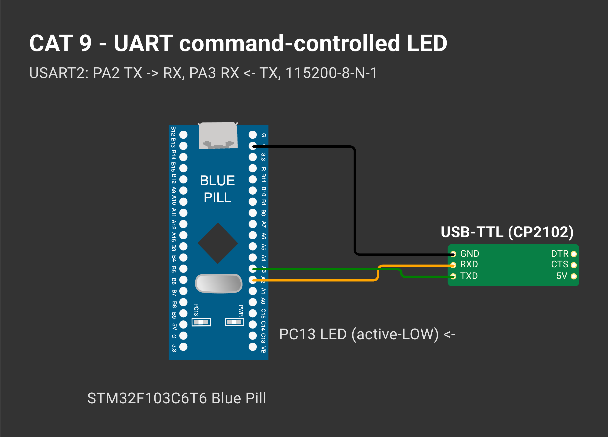

# EXPERIMENT DETAILS

**EXP:** CONTINUOUS ASSESSMENT 9

**DATE:** 28/09/2026

**NAME OF EXP:** STM32 UART Command Controlled LED

**HARDWARE SETUP / PLATFORM:** Blue Pill STM32F103C6T6 (Cortex-M3, 72 MHz) + USB-to-TTL + PuTTY — STM32CubeMX + Keil MDK-ARM (STM32CubeIDE project also included), STM32 HAL, PuTTY

---

## TASK 9A : Basic UART Communication

### 1. Circuit Diagram

| STM32 | USB-to-TTL |
|---|---|
| PA2 USART2_TX | RX |
| PA3 USART2_RX | TX |
| GND | GND |

USART2 asynchronous, **115200-8-N-1**. LED on PC13.



*Drawn on [Wokwi](https://wokwi.com). To open and edit it: start a new project on wokwi.com, paste [`wokwi/diagram.json`](wokwi/diagram.json) into its diagram.json tab, and add the `wokwi/*.chip.json` files (if any) with **New file**. The AT89S52, USB-TTL, ULN2003, USBasp and ST-LINK boards are custom chips (pin names added as labels). The ESP-01 part stands in for the Wemos D1 mini and the BMP180 module for the BME280 (same AT firmware / same 4-pin I²C header); the Nucleo-64 graphic is labelled as the F401RE.*

### 2. Core Logic / Pseudocode / Code Base

**Working Principle:**

`HAL_UART_Receive()` polls with a 10 ms timeout so the loop never blocks. A received byte is echoed; if nothing arrives for 1 s (`HAL_GetTick()`), the character `A` is transmitted.

**Pseudocode:**

1. Print a banner.
2. Try to receive one byte (10 ms).
3. If received: echo (CR → CR LF), note the time.
4. Else if 1 s passed: send `A`, note the time.

**Code Base:**

- Project files: `CAT09A_Basic_UART_Communication.ioc` (CubeMX configuration), `MDK-ARM/CAT09A_Basic_UART_Communication.uvprojx` (Keil MDK), `.project` / `.cproject` (STM32CubeIDE); application code in `Core/Src/main.c`.
- `uart_send_str()`, `uart_send_char()`

**Expected Output:**

```
CAT9A - STM32 Blue Pill UART ready (115200-8-N-1)
AAAAhelloAAA
```

### 3. Inference

Both directions work at matching baud rate and frame format.
